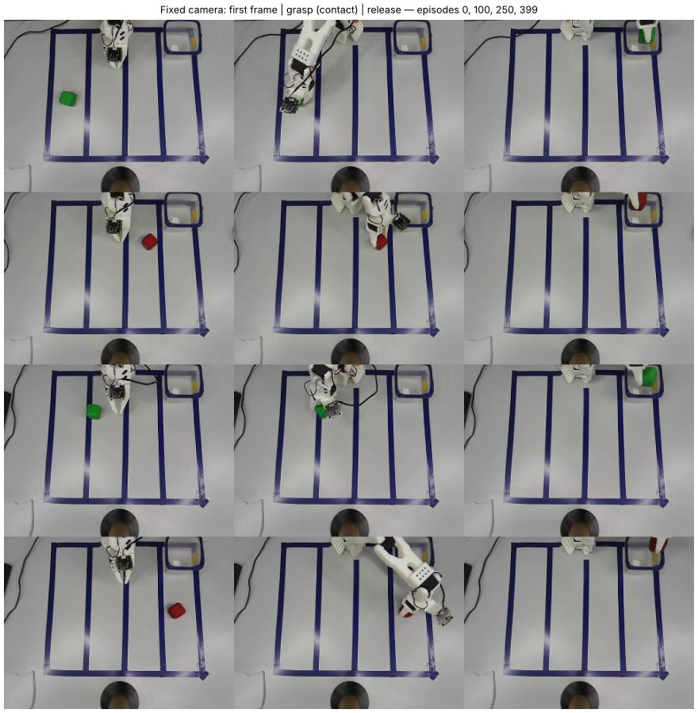
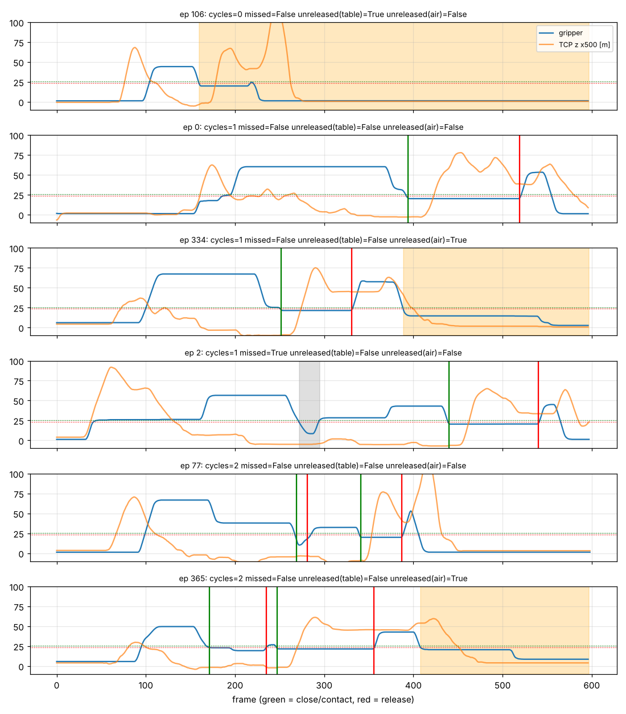
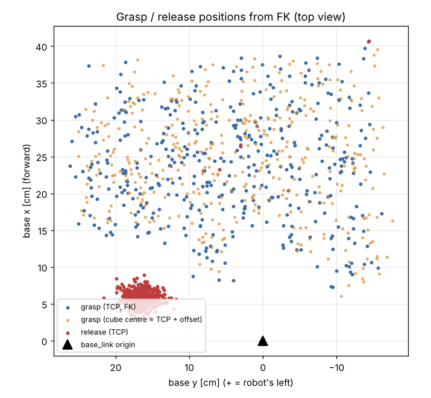
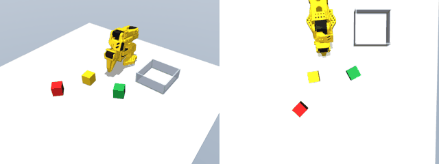
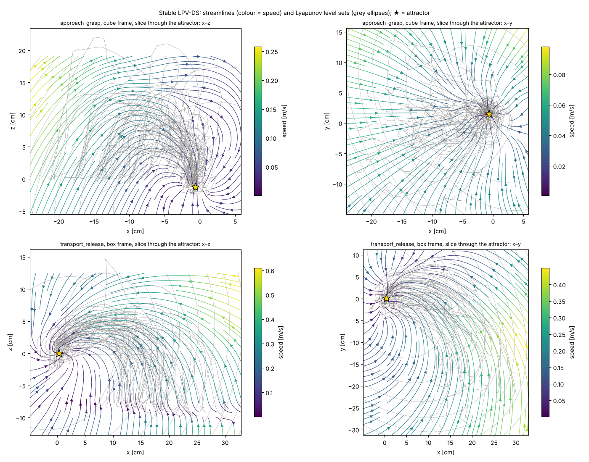
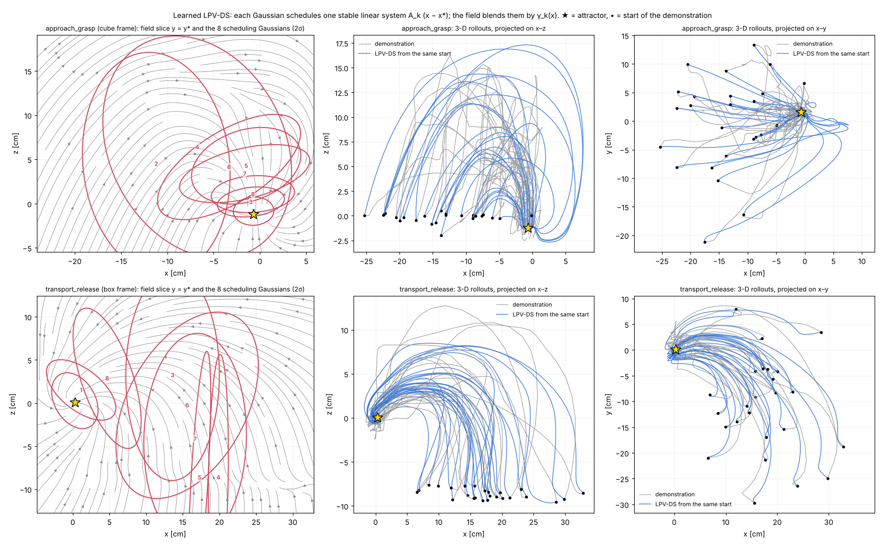
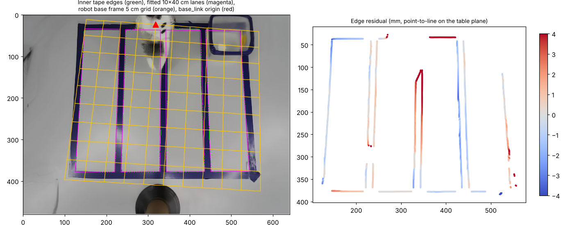

# SO101-ARM-TP-GMM

Aprendizaje por demostración (*Learning from Demonstration*) con **Task-Parameterized Gaussian
Mixture Models (TP-GMM)** para el brazo **SO-101** (LeRobot, 5 DOF + gripper).

Las demostraciones son las del dataset de teleoperación
[`SebRivGar/dataset3`](https://huggingface.co/datasets/SebRivGar/dataset3) (formato LeRobot v3.0),
grabado originalmente para entrenar ACT. La tarea es *pick-and-place*: tomar un cubo de color
(amarillo, rojo, verde o azul) de la mesa y dejarlo en un recipiente fijo.



*Cámara fija (`observation.images.top`): primer frame, instante de agarre e instante de soltado en
cuatro episodios. El robot está arriba al centro y el recipiente arriba a la derecha. Los carriles de
cinta azul miden 10 × 40 cm por dentro.*

---

## Estado

| Fase | Contenido | Estado |
|---|---|---|
| 0 | Inspección del dataset → [`docs/dataset_report.md`](docs/dataset_report.md) | ✅ |
| 0b | Calibración de la cámara con la cuadrícula de cinta → [`docs/camera_calibration.md`](docs/camera_calibration.md) | ✅ preliminar |
| 1 | Cinemática: FK desde el URDF e IK numérica (posición + yaw, límites, pitch suave) → [`docs/kinematics_report.md`](docs/kinematics_report.md) | ✅ |
| 2 | Segmentación en ciclos y primitivas (approach+grasp, transport+release) con filtros físicos → [`docs/segmentation_report.md`](docs/segmentation_report.md) | ✅ |
| 3 | Visión con la cámara fija: detección HSV, yaw plegado, homografía con RANSAC, validación de escena → [`docs/vision_report.md`](docs/vision_report.md) | ✅ |
| 4 | TP-GMM en numpy (EM + GMR, producto de Gaussianas, BIC): segmentado (principal) y monolítico; en paralelo, planificador por IK sobre las mismas primitivas → [`docs/tpgmm_report.md`](docs/tpgmm_report.md) | ✅ |
| 5 | Evaluación leave-one-out (segmentado vs monolítico vs planificador IK vs LPV-DS), inferencia imagen → trayectoria articular, stub del robot → [`docs/evaluation_report.md`](docs/evaluation_report.md) | ✅ |
| 6 | Alternativa estable: LPV-DS (campo de velocidades con estabilidad garantizada) y prueba de perturbaciones → [`docs/lpvds_report.md`](docs/lpvds_report.md), [`docs/perturbation_report.md`](docs/perturbation_report.md), [`docs/ds_field.md`](docs/ds_field.md) | ✅ experimental |
| 7 | Simulación en MuJoCo con 3 cubos aleatorios y las políticas aprendidas → [`docs/mujoco_sim.md`](docs/mujoco_sim.md) | ✅ |

## Instalación

```bash
pip install -e ".[dev]"
```

Python ≥ 3.10. Para decodificar los videos AV1 basta PyAV, cuyas *wheels* ya incluyen FFmpeg con
**libdav1d**; no hace falta torchcodec. `lerobot` solo se necesita en la máquina conectada al robot
(`pip install -e ".[robot]"`).

## Uso

Descargar el dataset (unos 1 GB: datos tabulares y solo la cámara fija) y generar el reporte:

```bash
python scripts/inspect_dataset.py --download
```

Calibrar la cámara con la cuadrícula de cinta y registrarla con la base del robot:

```bash
python scripts/calibrate_camera_grid.py
```

Correr los tests (los que usan el dataset real se saltan si no está descargado):

```bash
python -m pytest
```

Pipeline completo, en orden (cada paso escribe lo que usa el siguiente):

```bash
python scripts/segment_dataset.py
```

```bash
python scripts/vision_pipeline.py
```

```bash
python scripts/train.py
```

```bash
python scripts/evaluate_offline.py --workers 4
```

Inferencia desde una foto de la cámara fija, con el robot en reposo:

```bash
python scripts/infer.py --image foto.png --colors red yellow green
```

Ejecutar en el robot real (en la máquina conectada al brazo; probar antes con `--dry-run`):

```bash
python -m so101_tpgmm.robot.so101_runner --npz outputs/inference/foto.npz --port /dev/ttyACM0
```

Cualquier parámetro de `configs/default.yaml` se puede sobrescribir desde la línea de comandos:

```bash
python scripts/inspect_dataset.py --set gripper.open_threshold=26 gripper.close_threshold=23
```

---

## Lo que dicen los datos (Fase 0)

Los detalles y todas las cifras están en [`docs/dataset_report.md`](docs/dataset_report.md), que se
regenera con el script.

- **Formato:** LeRobot v3.0, 30 fps, 400 episodios de ~20 s (duración fija), una tarea y dos cámaras
  de 640×480 en AV1 (fija y muñeca). El `action` del líder **no se usa**.
- **Unidades de `observation.state`: grados.** No se supuso: el modo `DEGREES` de LeRobot deja una
  huella exacta, porque todos los valores son múltiplos de 360/4095°. Además aparecen valores de
  −105° y +110,6°, imposibles en el modo −100…100, que recorta. El gripper está en 0…100.
- **Un cubo por episodio.** 392 de 400 episodios tienen exactamente un ciclo agarre→soltado.
- **El gripper tiene tres niveles, no dos:** cerrado vacío (0–12), **sujetando el cubo** (~20, las
  mordazas se detienen sobre el cubo de 4 cm) y abierto (≥ 25). Por eso se usa histéresis y
  clasificación por meseta. Un umbral único produce ciclos fantasma, por ejemplo cuando el operador
  cierra a medias en el aire.



*Señal del gripper (azul) y altura del TCP por FK (naranja). Verde marca el contacto y rojo el
soltado; en gris, agarre fallido; en naranja, meseta "sujetando" sin soltado (a la altura de la mesa
o en el aire).*

- **La FK es consistente:** todos los agarres ocurren a la misma altura (TCP entre −1,9 y +1,0 cm en
  el 98 % de los casos), lo que valida unidades, signos y el cero del URDF. Los soltados se agrupan
  en el recipiente.



- **Límites articulares:** la pose de reposo deja `shoulder_lift` en −104°, fuera del límite del
  URDF (±100°). Solo el 36 % de los frames respeta todos los límites del URDF, así que la IK usará
  la unión de los límites del URDF y el rango observado.

## Simulación en MuJoCo

Tres cubos (rojo, amarillo, verde) en posiciones y orientaciones aleatorias dentro del espacio de trabajo
demostrado; su pose es conocida (sin cámara). Para cada cubo, en el orden de colores, se ejecuta el mismo
pipeline que en el robot: articulaciones medidas → política → IK → trayectoria articular a los servos
simulados → vuelta a casa. Modelo oficial del SO-101 (TheRobotStudio, Apache-2.0), que coincide con nuestra
FK a menos de 4 µm. Detalle, supuestos y límites en [`docs/mujoco_sim.md`](docs/mujoco_sim.md).



Cubos dentro del recipiente (30 episodios × 3 cubos por condición; las mismas disposiciones para todas las
políticas; física de contacto pura):

| política | un punto de liberación (como se entrenó) | casillas en el recipiente | con ruido de percepción de 8 mm (casillas, agarre asistido) |
|---|---|---|---|
| TP-GMM segmentado | 77 % | **92 %** | **84 %** |
| TP-GMM monolítico | 76 % | 89 % | 84 % |
| Planificador IK | **81 %** | 82 % | 68 % |
| LPV-DS | 59 % | 60 % | 64 % |

- **El TP-GMM segmentado es el mejor** en tres de las cuatro condiciones sin ruido (89 % en promedio).
- **Un solo punto de liberación apila los cubos.** Cada demostración tenía un solo cubo, así que la política
  suelta los tres en el mismo lugar y el tercero se cae de la pila. Desplazar el marco del recipiente por
  cubo (casillas) es un cambio de parámetro de tarea en ejecución, sin reentrenar, y sube el TP-GMM de 77 a
  92 %.
- **LPV-DS agarra muchos menos cubos** (61 % frente a 97 %). La pose de reposo deja la pinza a la altura de
  la mesa, y el campo, que depende solo de la posición, va casi en horizontal hacia el cubo con la pinza aún
  cerrada y lo empuja. El TP-GMM reproduce el "subir y luego acercarse" del operador. La evaluación offline
  no podía ver este problema.
- **El planificador IK** omite el 11–14 % de los cubos porque algún punto de su trayectoria no es alcanzable.
- **La percepción importa tanto como la política:** con 8 mm de ruido (el error típico de la visión actual)
  el TP-GMM baja de 97 a 84 % incluso con agarre asistido.

Ejecutarla:

```bash
pip install -e ".[sim]"
```

```bash
scripts/fetch_so101_mujoco.sh
```

```bash
MUJOCO_GL=egl python scripts/simulate_mujoco.py --episodes 30 --noise-mm 0 8 --video 1
```

## TP-GMM vs LPV-DS: ¿vale la pena?

Leave-one-out sobre los 366 ciclos utilizables (mediana; detalle y pruebas pareadas en
[`docs/evaluation_report.md`](docs/evaluation_report.md)):

| modelo | desviación de trayectoria [mm] | error de agarre [mm] | error de liberación [mm] | ciclos 100 % factibles por IK |
|---|---|---|---|---|
| TP-GMM segmentado | **21.1** | **10.7** | 21.0 | 100 % |
| TP-GMM monolítico | 25.1 | 12.8 | 21.4 | 100 % |
| Planificador IK | 27.8 | 11.8 | 20.9 | 93 % |
| LPV-DS | 25.7 | 11.8 | 21.1 | 97 % |

Campos aprendidos por LPV-DS, una primitiva por fila: marco del cubo (arriba) y del recipiente (abajo).
Las líneas de flujo muestran la dirección y la rapidez del campo; las elipses grises son los conjuntos de nivel
de la función de Lyapunov, que decrece a lo largo de todo el campo:



Las 8 Gaussianas de cada primitiva (izquierda) reparten el espacio y cada una activa un sistema lineal estable
A_k(x − x*); el campo es su mezcla ponderada por γ_k(x). Al centro y a la derecha, el DS integrado en 3-D
desde el inicio de 25 demostraciones (azul) frente a esas demostraciones (gris): todas convergen, y se ve el
desborde más allá del cubo en algunas aproximaciones.



- **Precisión:** el LPV-DS no mejora. Llega al cubo casi igual de bien (11,8 vs 10,7 mm; el piso lo
  ponen la visión y el operador), pero sigue peor el camino demostrado: asigna una sola velocidad a cada
  posición y las demostraciones cruzan las mismas regiones a ritmos distintos.
- **Robustez** ([`docs/perturbation_report.md`](docs/perturbation_report.md), simulación cinemática del
  TCP): el seguimiento indexado en el tiempo con realimentación resiste empujones, desplazamientos del
  cubo y un robot más lento; falla solo ante una pausa larga cerca del agarre (el gripper cierra a 35 mm
  del cubo). El LPV-DS es inmune a eso, pero **la detención de fase** (el reloj de la referencia espera
  al robot) le da la misma inmunidad al TP-GMM sin cambiar el modelo.
- **Advertencia de forma:** en ~18 % de las aproximaciones nominales el LPV-DS pasa por encima del cubo
  y baja por el lado opuesto (demostraciones: 11 %, con desbordes mucho menores).
- **Simulación física** ([`docs/mujoco_sim.md`](docs/mujoco_sim.md)): el LPV-DS agarra el 61 % de los cubos
  frente al 97 % del TP-GMM, porque desde la pose de reposo (pinza a la altura de la mesa) su campo barre la
  mesa hacia el cubo en lugar de subir primero.
- **TP-LPV-DS:** no implementado. El recipiente nunca se mueve en el dataset, así que el marco del
  recipiente no aporta nada que aprender; solo tendría sentido con demostraciones nuevas moviéndolo.
- **Recomendación:** mantener el TP-GMM segmentado como política principal y ejecutarlo con detención
  de fase en el robot (hoy solo está en `scripts/perturbation_benchmark.py`; falta llevarla a
  `robot/so101_runner.py`, que reproduce un plan abierto). El LPV-DS queda como alternativa cuando se necesite convergencia garantizada
  desde estados lejos de las demostraciones.

## Geometría cámara ↔ robot

Se resolvió en dos pasos.

**1. Solo con el dataset.** Se emparejó el cubo detectado en el primer frame con la posición de
la FK en el agarre ([reporte §6](docs/dataset_report.md)). La relación píxel→mesa sale con ~8 mm de
error mediano. Como hallazgo, el centro del cubo agarrado **no** coincide con `gripper_frame_link`:
hay un desplazamiento en el marco de la herramienta, porque el SO-101 tiene una sola mordaza móvil.
La posición e inclinación de la cámara quedaron mal determinadas.

**2. Con la cuadrícula de cinta** (carriles de 10 × 40 cm por dentro, medidos en el montaje real;
[`docs/camera_calibration.md`](docs/camera_calibration.md)). Se ajustó la homografía a unos 2700
puntos de borde interior con precisión subpíxel. Se usan bordes y no esquinas porque el robot y el
recipiente tapan partes de la cuadrícula.



| Magnitud | Valor | Cómo se obtiene |
|---|---|---|
| Error de la homografía sobre la cinta | 0,9 mm (mediana) | ajuste a los bordes |
| Ancho de la cinta | 15,6 mm | estimado |
| Focal | 496 px (HFOV 66°) | homografía + altura medida de 55 cm |
| Inclinación del eje óptico | 9,4° | *keystone* de la cuadrícula |
| Lente sobre la mesa, marco base (x, y) | (35,6; 1,3) cm, a ~32 cm del eje pan | supone el punto principal en el centro (±2 cm por cada 20 px) |
| Origen de `base_link` en la cuadrícula | 1,8 cm más allá de la cinta del lado del robot, 2,1 cm del eje central | registro cubos ↔ FK |
| Escala FK vs cinta | 0,953 | ⚠ la FK sale un 4,7 % más corta que la cinta; pendiente de verificar en el robot |

**Mediciones pendientes en el robot real** (cualquiera de ellas mejora la calibración):

1. Distancia horizontal del eje de `shoulder_pan` al punto de la mesa bajo la lente.
2. Posición de la base respecto de la cinta, para confirmar los 1,8 cm y −2,1 cm de arriba.
3. Desplazamiento real del TCP entre dos poses separadas ~30 cm, para resolver la discrepancia de
   escala del 4,7 %.
4. Opcional: calibración de intrínsecos con un tablero de ajedrez, para obtener el punto principal
   y la distorsión.

---

## Estructura

```
configs/default.yaml          umbrales, rutas y medidas de la escena (YAML)
so101_tpgmm/
  config.py                   carga de YAML y overrides --set
  data/
    lerobot_dataset.py        lector LeRobot v3.0 (parquet + MP4) sin depender de lerobot
    video.py                  decodificación AV1 con verificación de timestamp
    units.py                  inferencia de unidades y conversión explícita a radianes
  kinematics/
    urdf.py, fk.py            parser de URDF y FK vectorizada (so101_new_calib.urdf incluido)
    ik.py                     IK numérica: posición + yaw de muñeca, límites, pitch suave
  segmentation/
    gripper.py                eventos del gripper: histéresis, 3 niveles, duración mínima
    primitives.py             ciclos y primitivas, filtros físicos, puntos clave
  vision/
    camera_pose.py            homografía con offset del cubo, descomposición, chequeo de espejo
    grid_calibration.py       bordes subpíxel de la cinta y ajuste punto-a-recta
    detection.py              detección de cubos por color (HSV), minAreaRect, yaw plegado a ±45°
    geometry.py               píxel → base (homografía, yaw por la homografía, distorsión opcional)
    calibration.py            homografía con RANSAC desde el propio dataset
    scene.py                  frame de referencia, validación de escena, asociación ciclo↔cubo
    draw.py                   dibujos de depuración
  tpgmm/
    gmm.py                    densidades, producto de Gaussianas, GMR
    tpgmm.py                  TP-GMM: EM, inicialización k-means en el tiempo, BIC, reproducción
    demos.py                  demostraciones, marcos cubo/caja, simetría de 90° del cubo
    policy.py                 política segmentada / monolítica, continuidad entre primitivas
    cube_symmetry.py          elección entre las 4 orientaciones equivalentes del cubo
    ds.py                     sistema dinámico GMR-DS (campo vectorial) a partir de las demostraciones
  planner/ik_planner.py       planificador geométrico por waypoints (línea base)
  lpvds/
    lpvds.py                  LPV-DS estable por construcción (Lyapunov cuadrático), DS escalares
    policy.py                 política LPV-DS por primitiva en el marco del objetivo, gripper por estado
  evaluation/metrics.py       métricas: RMSE, error de agarre/soltado, factibilidad IK
  inference.py                imagen → cubos → trayectorias → articulaciones (orden de colores)
  policies.py                 carga cualquier política entrenada por nombre
  sim/
    scene.py                  escena MuJoCo: SO-101 oficial, dedos por cajas, mesa inclinada (FK), recipiente, cubos
    runner.py                 servos de posición a 30 Hz, mapeo del gripper, agarre por contacto o asistido
    episode.py                episodio: cubos aleatorios, posición en la convención de la política, ejecución
  robot/so101_runner.py       stub para ejecutar en SO101Follower (LeRobot), con modo dry-run
scripts/
  inspect_dataset.py          Fase 0: reporte, figuras y CSV por episodio
  calibrate_camera_grid.py    calibración métrica con la cuadrícula
  check_kinematics.py         Fase 1: ida y vuelta FK→IK, trayectorias grabadas, mapa de alcance
  segment_dataset.py          Fase 2: tabla de ciclos/primitivas, reporte y figuras
  vision_pipeline.py          Fase 3: detección, calibración, marcos del cubo por ciclo, reporte
  debug_detections.py         imágenes con las detecciones dibujadas (episodios o cualquier imagen)
  train.py                    Fase 4: entrena TP-GMM segmentado, monolítico y el planificador por IK
  evaluate_offline.py         Fase 5: validación leave-one-out por ciclo y figuras
  infer.py                    Fase 5: imagen (o episodio) → .npz/.csv con la trayectoria articular
  plot_ds_field.py            campo vectorial y divergencia del DS aprendido (diagnóstico)
  train_lpvds.py              entrena LPV-DS y genera su reporte (campo y conjuntos de nivel de Lyapunov)
  plot_lpvds.py               figura de Gaussianas de LPV-DS y rollouts vs demostraciones
  perturbation_benchmark.py   robustez: control indexado en el tiempo vs LPV-DS ante perturbaciones
  fetch_so101_mujoco.sh       descarga el modelo MuJoCo oficial del SO-101 (TheRobotStudio, Apache-2.0)
  simulate_mujoco.py          simulación MuJoCo: 3 cubos aleatorios, las 4 políticas, videos y reporte
docs/
  dataset_report.md           reporte del dataset (generado)
  camera_calibration.md       calibración de la cámara (generado)
  kinematics_report.md        verificación de FK/IK y espacio alcanzable (generado)
  kinematics_paper_review.md  revisión de la cinemática de Rivas (2026) contra el URDF
  segmentation_report.md      segmentación en primitivas (generado)
  segmentation_cycles.csv     un registro por ciclo: índices, banderas y puntos clave
  vision_report.md            visión y calibración píxel→base (generado)
  cube_frames.csv             marco del cubo por ciclo (visión y FK), color y banderas
  tpgmm_report.md             entrenamiento, selección por BIC, componentes (generado)
  evaluation_report.md        comparación leave-one-out de los cuatro modelos (generado)
  mujoco_sim.md               simulación MuJoCo de las políticas (generado)
  ds_field.md                 campo vectorial / divergencia del GMR-DS (generado)
  lpvds_report.md             modelo LPV-DS (generado)
  perturbation_report.md      prueba de perturbaciones (generado)
  silent_failures.md          catálogo de fallas silenciosas y sus guardas
  episodes_summary.csv        ciclos, instantes y posiciones por episodio
tests/                        pytest (103 tests)
```

## Decisiones de diseño

| Decisión | Justificación |
|---|---|
| No importar `lerobot` en el pipeline offline | El formato v3.0 (parquet + MP4) se lee directamente, así que entrenamiento y evaluación corren sin torch. `lerobot` solo hace falta en el runner del robot. |
| Unidades inferidas, nunca supuestas | Confundir grados con −100…100 no produce errores, solo poses plausibles pero falsas. `infer_joint_units` verifica la cuantización y el rango; la FK solo acepta radianes y la conversión es explícita (`fk_from_dataset`). |
| Frames verificados por timestamp | v3.0 empaqueta muchos episodios por MP4. `VideoReader` lanza un error si el frame decodificado se aleja más de 0,4 frame del tiempo pedido. |
| Gripper con histéresis y 3 niveles | La meseta "sujetando" (~20) y las aperturas pequeñas (25–28) rondan cualquier umbral único. Además se exige una duración mínima y, en la Fase 2, un filtro de altura: sin apilamiento, todo agarre real ocurre a la altura de la mesa. |
| Centro del cubo = TCP + offset | `gripper_frame_link` no es el centro del cubo agarrado. Modelarlo baja el error de calibración de 10,6 a 8,4 mm (homografía) y de 15,1 a 9,9 mm (registro con la cuadrícula). |
| Calibración por bordes, no por esquinas | El robot y el recipiente ocultan esquinas. Miles de puntos de borde con restricciones punto-a-recta son robustos a esas oclusiones y dan precisión submilimétrica sobre la mesa. |
| Incertidumbre reportada explícitamente | La posición y la inclinación de una cámara casi cenital están acopladas. Se reportan intervalos por bootstrap y la sensibilidad al punto principal en lugar de un solo número. |

Las fallas silenciosas identificadas y sus guardas (tests o asserts) están en
[`docs/silent_failures.md`](docs/silent_failures.md).

## Referencias

- Calinon, S. (2016). *A tutorial on task-parameterized movement learning and retrieval.*
  Intelligent Service Robotics, 9(1).
- LeRobot: <https://github.com/huggingface/lerobot>
- URDF del SO-101: [TheRobotStudio/SO-ARM100](https://github.com/TheRobotStudio/SO-ARM100)
  (`Simulation/SO101/so101_new_calib.urdf`)
