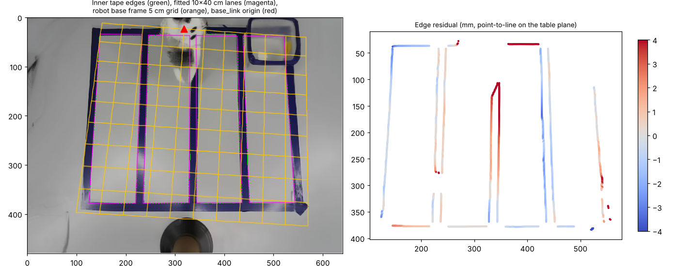

# Camera calibration from the taped grid

_Generated by `scripts/calibrate_camera_grid.py`._

Input: 4 taped lanes, inner size **10 × 40 cm** (measured), camera height **55 cm** (measured, approx.), cube side 4 cm.

## 1. Pixel → table homography

- 2708 sub-pixel inner-edge samples (the robot and the box hide parts of the grid, so edges are used instead of corners).
- Point-to-line residual: median 0.88 mm, RMS 2.16 mm.
- Estimated tape width: 15.6 mm.
- Per-lane width implied by the residuals (hand-taped tolerance): lane 0: 101.0 mm, lane 1: 101.5 mm, lane 2: 96.0 mm, lane 3: 101.7 mm.
- One-coefficient radial distortion fitted as a diagnostic: k1 = -0.070 (normalised by f = 500 px), RMS 2.12 mm vs 2.16 mm without it. Not significant enough to be separated from lane-taping errors with parallel lines only → **not used**.

## 2. Camera pose (principal point assumed at the image centre)

- Focal length from the measured height: **496 px** (HFOV 65.6°). Agrees with the dataset-only estimate (493–504 px, `dataset_report.md` §6).
- Optical-axis tilt: **9.4°**; directly visible as keystone (the far end of the grid is wider in the image than the end next to the robot).
- Lens above the table at base (x, y) = **(35.6, 1.3) cm**, i.e. **31.7 cm** in front of the `shoulder_pan` axis; z = 54.6 cm in the base frame (table at z = -0.4 cm).

Sensitivity (the dominant uncertainty is the unknown principal point):

| assumption | lens x from pan axis | lens y | tilt |
|---|---|---|---|
| nominal | 31.7 cm | 1.3 cm | 9.4° |
| principal point shifted (+0, -20) px | 29.4 cm | 1.2 cm | 9.3° |
| principal point shifted (+0, +20) px | 33.9 cm | 1.4 cm | 9.4° |
| principal point shifted (-20, +0) px | 31.8 cm | -0.9 cm | 9.4° |
| principal point shifted (+20, +0) px | 31.6 cm | 3.4 cm | 9.4° |
| camera height 50 cm (f = 449 px) | 30.1 cm | 1.4 cm | 8.5° |
| camera height 60 cm (f = 543 px) | 33.4 cm | 1.1 cm | 10.2° |

The dataset-only estimate (FK homography) gave 18–24 cm from the pan axis; the grid, being sub-millimetre on the table, constrains the keystone much better, so this estimate supersedes it **if** the principal point is near the centre. A tape measurement of the lens footprint (or a checkerboard intrinsic calibration) settles it.

## 3. Grid ↔ robot base

Registration from 389 pairs (cube top-face centre back-projected to z = 4 cm ↔ FK at grasp), rigid 2-D transform + cube-centre offset in the TCP frame:

| model | median error | p90 |
|---|---|---|
| rigid, TCP origin | 15.1 mm | 29.0 mm |
| rigid + cube offset in TCP frame | 9.9 mm | 18.9 mm |
| similarity (free scale) + offset | 9.3 mm | 17.8 mm |

- Grid rotation w.r.t. base: 93.6°; grid origin at base (43.0, -17.5) cm.
- `base_link` origin in grid coordinates: (20.2, 41.8) cm, i.e. 1.8 cm beyond the inner edge of the tape next to the robot and -2.1 cm from the grid's centre line (grid inner width 44.7 cm). **Physical check:** measure these two distances on the table.
- Cube-centre offset in the TCP frame: (-17.1, -21.2, -20.7) mm. It differs from the dataset-only fit (−7.5, −17.2, −16.9) mm mainly along x: this component is weakly identifiable and partly traded against the rigid transform; Phase 3 re-estimates it.
- **FK vs tape scale: 0.953** — FK distances are 4.7 % shorter than tape distances. Candidates: URDF link lengths vs the real arm, follower joint calibration (gear backlash/offsets), or lanes not exactly 10 × 40 cm. To check on the robot: command two poses ~30 cm apart and measure the TCP displacement.
