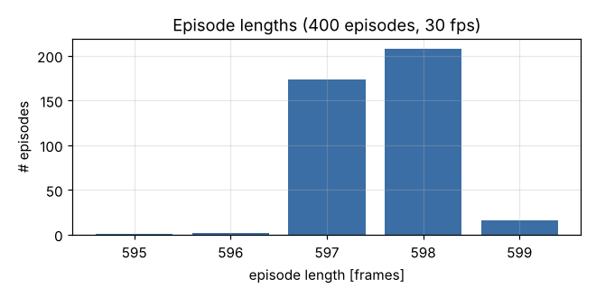
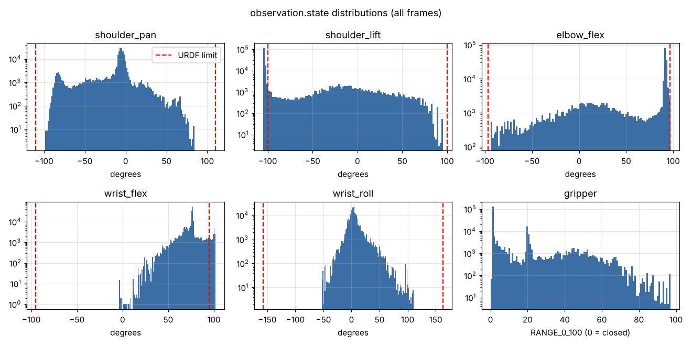
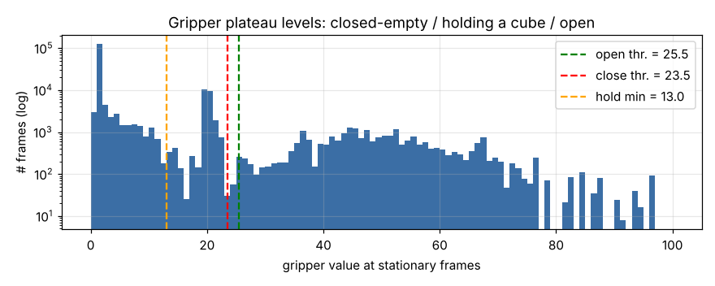
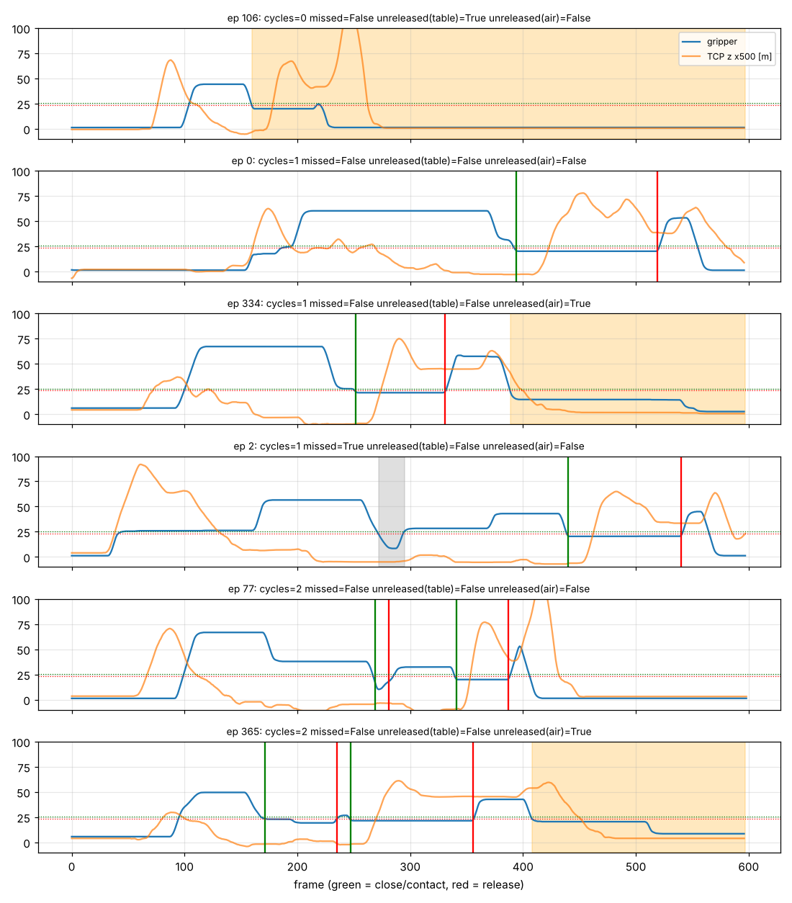
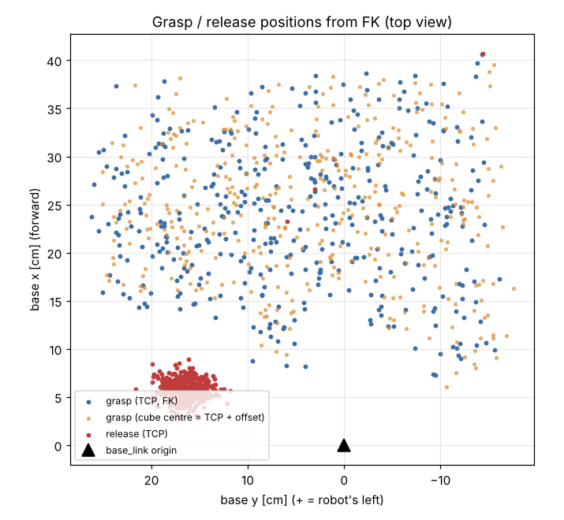
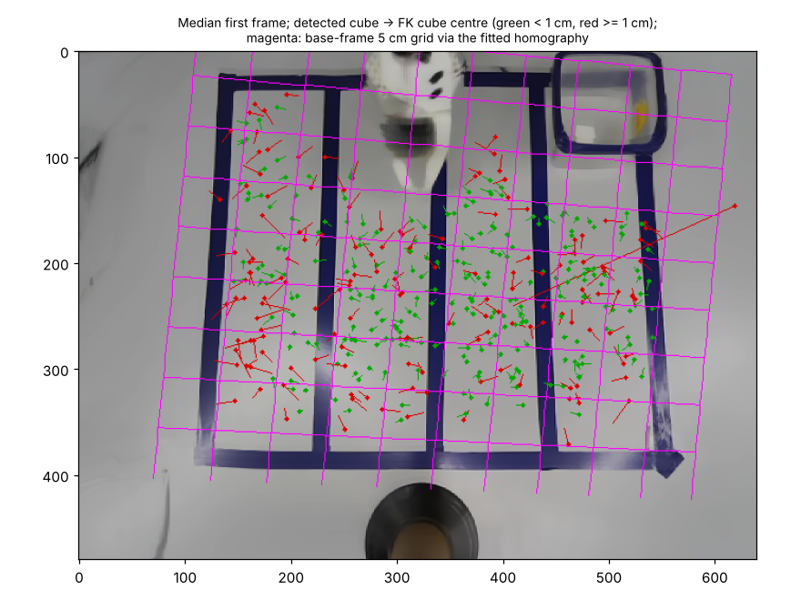

# Dataset report — `SebRivGar/dataset3` (Phase 0)

_Generated by `scripts/inspect_dataset.py`; numbers are recomputed on every run._

## 1. Format

- LeRobot `codebase_version`: **v3.0** (`robot_type: so_follower`)
- fps: **30**; episodes: **400**; frames: **239036**; tasks: 1 (`Grasp cube and put it in the box`)
- Episode length: min 595, median 598, max 599 frames (≈19.9 s). Lengths are near-constant: episodes were recorded with a fixed duration, not cut at task completion (most of the tail is the arm resting at home). Per-episode lengths are in `docs/episodes_summary.csv`.

### Keys

| key | dtype | shape | names |
|---|---|---|---|
| action | float32 | [6] | shoulder_pan.pos, shoulder_lift.pos, elbow_flex.pos, wrist_flex.pos, wrist_roll.pos, gripper.pos |
| observation.state | float32 | [6] | shoulder_pan.pos, shoulder_lift.pos, elbow_flex.pos, wrist_flex.pos, wrist_roll.pos, gripper.pos |
| observation.images.wrist | video | [480, 640, 3] |  |
| observation.images.top | video | [480, 640, 3] |  |
| timestamp | float32 | [1] |  |
| frame_index | int64 | [1] |  |
| episode_index | int64 | [1] |  |
| index | int64 | [1] |  |
| task_index | int64 | [1] |  |

### Cameras

| key | resolution | codec | pix_fmt | fps | GOP (video.g) | role here |
|---|---|---|---|---|---|---|
| observation.images.wrist | 640x480 | av1 | yuv420p | 30 | 2 | wrist (not used) |
| observation.images.top | 640x480 | av1 | yuv420p | 30 | 2 | fixed, top-down (used) |

The leader-arm `action` is present but **not used** (we learn from what the follower actually did).

## 2. Units of `observation.state` (inferred, not assumed)

LeRobot normalizes Feetech ticks (`motors_bus.py::_normalize`): `RANGE_M100_100` = `clamp(raw)` mapped to [−100, 100]; `DEGREES` = `(raw − mid)·360/4095` (**not** clamped); the gripper always uses `RANGE_0_100`. `raw`, `min`, `max` are integers, which leaves a fingerprint in the floats.

**Result: arm joints in `degrees`; gripper in `RANGE_0_100`.** Evidence:

- All 5 arm joints are exact multiples of 360/4095 deg (max residual 4.29e-05 ticks), with a constant integer/half-integer offset per joint: the LeRobot DEGREES fingerprint.
- Some arm values have |v| > 100, impossible in RANGE_M100_100 (LeRobot clamps).
- Gripper is quantized in steps of 100/1451: RANGE_0_100 with a calibrated span of 1451 ticks (127.6 deg).
- `meta/info.json` gives only the names (`shoulder_pan.pos`, …), no unit; current LeRobot `SOFollowerConfig.use_degrees` defaults to `True`, consistent with the above.
- Step = 360/4095 = 0.087912° (= 8/91°). Conversion used everywhere: `rad = deg2rad(value)` (`so101_tpgmm/data/units.py`), the zero being the middle of the calibrated range, which is the zero of `so101_new_calib.urdf` (the same mapping LeRobot's own `RobotKinematics` uses).

| joint | min [deg] | max [deg] | q01 / q99 | URDF limits [deg] | % frames outside URDF | max resid [ticks] | offset |
|---|---|---|---|---|---|---|---|
| shoulder_pan | -98.6 | 84.2 | -86.0 / 46.0 | [-110.0, 110.0] | 0.0 | 4.3e-05 | integer |
| shoulder_lift | -105.1 | 95.2 | -104.6 / 70.0 | [-100.0, 100.0] | 57.2 | 4.3e-05 | integer |
| elbow_flex | -94.0 | 96.9 | -81.3 / 95.3 | [-96.8, 96.8] | 0.0 | 4.3e-05 | integer |
| wrist_flex | -3.6 | 101.8 | 38.6 / 101.0 | [-95.0, 95.0] | 6.9 | 4.3e-05 | half-tick |
| wrist_roll | -53.1 | 110.6 | -23.3 / 51.5 | [-157.2, 162.8] | 0.0 | 4.3e-05 | half-tick |

Only **35.8%** of frames are inside all URDF limits. The rest pose has `shoulder_lift` ≈ −104.4°, beyond the URDF limit of −100°, and `wrist_flex` exceeds +95° at times. Consequence for Phase 1: IK limits must be the union of URDF limits and the observed range (otherwise IK reports the demonstrations themselves as infeasible).

## 3. Gripper signal and grasp cycles

- Range: 0.07 … 96.90 (`RANGE_0_100`, 0 = closed; span 1451 ticks).
- Stationary plateaus fall in **three** bands, not two:
  - closed-empty ≈ 0–12 (rest; also the operator partially closing the leader),
  - **holding a cube** ≈ 19.3–22.2 (median 20.1; the jaws stop on the 4 cm cube),
  - open ≥ ~25 (approach opening 25–90, release opening sometimes only 26–30).
- A single threshold either merges *holding* with *open* or chatters between them. The detector (`segmentation/gripper.py`) uses a median filter, **hysteresis** (OPEN > 25.5, CLOSED < 23.5), debouncing (OPEN ≥ 0.15 s) and classifies each closed plateau by level (hold ∈ [13.0, 23.5], ≥ 0.4 s). Cycle = OPEN → HOLD → OPEN; contact and release instants are the first/last frame on the hold plateau.

### Cycles per episode

| cycles | episodes |
|---|---|
| 0 | 5 |
| 1 | 392 |
| 2 | 3 |

**Finding: one cube per episode.** The first frames inspected show a single cube on the table, and 392/400 episodes have exactly one grasp cycle. The "several cycles per episode" case is rare here; the pipeline still supports it.

Anomalies (all listed in `docs/episodes_summary.csv`):

- 0 cycles: [106, 143, 168, 221, 234]
- ≥ 2 cycles: [77, 365, 374]. Cycles whose contact is in the air (TCP z > 3 cm, i.e. **phantom cycles**, not grasps): [374]; the others are re-grasps at the table.
- Missed grasp (closed below the hold band, then re-opened): 1 episodes, e.g. [2]
- Hold at table height without a detected release: [106, 143, 168, 221, 234]. In [106, 143, 168, 221, 234] the hold plateau ends with the TCP over the box: the cube **was** released with a tiny opening (< open threshold) followed by a full closure. Phase 2 will take the end of the hold plateau as the release instant when the gripper goes from *hold* straight to *closed-empty*.
- Hold-level plateau **in the air** (TCP z > 3 cm) after the release: [334, 336, 339, 344, 347, 350, 355, 356, 357, 361, 362, 363, 365, 366, 370, 372]. These are the operator half-closing the gripper on the way home, **not** grasps — a level-only rule would create phantom cycles here. Phase 2 adds a height gate (no stacking ⇒ every real grasp starts at table height).

## 4. Grasp and release positions (FK)

- Grasp TCP height: median -0.7 cm, 1–99 % [-1.9, 1.0] cm. A tight band across the whole workspace is a check that the joint units, signs and URDF zero are right (a wrong sign or degrees/normalized mix-up spreads it by decimetres).
- With the cube-centre offset of §6, the grasped cube centre is at z ≈ 1.1 cm, so the table is at z ≈ -0.9 cm in the base frame (the robot base sits slightly below its URDF origin, or the table is not perfectly flat).
- Grasp XY spans x ∈ [7, 41] cm, y ∈ [-16, 26] cm.
- Release (TCP): mean (5.9, 16.3, 8.1) cm, std (2.4, 2.3, 1.6) cm → the fixed box, front-left of the robot (top-right in the image).

## 5. Video decoding and timestamp alignment

- AV1 decoders available through PyAV 19.0.2: `libdav1d, av1` (the PyAV wheel bundles FFmpeg with **libdav1d**; no torchcodec needed).
- Decoding speed ≈ 50 ms per random-access frame (seek + decode up to the next keyframe; GOP = 2).
- `timestamp == frame_index / fps` for every frame (max deviation 8.9e-07 s).
- Per-episode video span `(to − from)·fps` vs `length`: max deviation 0.00 frames.
- Decoded presentation time vs state timestamp (first/middle/last frame of episodes [0, 57, 114, 171, 228, 285, 342, 399]): max |Δt| = **0.00 ms** (tolerance 0.4 frame). `VideoReader` raises if the decoded frame is off by more than the tolerance.
- Fixed-camera files (only this camera was downloaded; the wrist camera is unused):

| file | codec | decoder | size | frames | episode frames | match |
|---|---|---|---|---|---|---|
| file-000.mp4 | libdav1d | libdav1d | 640x480 | 5973 | 5973 | True |
| file-001.mp4 | libdav1d | libdav1d | 640x480 | 5983 | 5983 | True |
| file-002.mp4 | libdav1d | libdav1d | 640x480 | 5978 | 5978 | True |
| file-003.mp4 | libdav1d | libdav1d | 640x480 | 5982 | 5982 | True |
| file-004.mp4 | libdav1d | libdav1d | 640x480 | 5982 | 5982 | True |
| file-005.mp4 | libdav1d | libdav1d | 640x480 | 5982 | 5982 | True |
| file-006.mp4 | libdav1d | libdav1d | 640x480 | 5980 | 5980 | True |
| file-007.mp4 | libdav1d | libdav1d | 640x480 | 5983 | 5983 | True |
| file-008.mp4 | libdav1d | libdav1d | 640x480 | 5982 | 5982 | True |
| file-009.mp4 | libdav1d | libdav1d | 640x480 | 5974 | 5974 | True |
| file-010.mp4 | libdav1d | libdav1d | 640x480 | 5975 | 5975 | True |
| file-011.mp4 | libdav1d | libdav1d | 640x480 | 5977 | 5977 | True |
| file-012.mp4 | libdav1d | libdav1d | 640x480 | 11947 | 11947 | True |
| file-013.mp4 | libdav1d | libdav1d | 640x480 | 11950 | 11950 | True |
| file-014.mp4 | libdav1d | libdav1d | 640x480 | 11955 | 11955 | True |
| file-015.mp4 | libdav1d | libdav1d | 640x480 | 11950 | 11950 | True |
| file-016.mp4 | libdav1d | libdav1d | 640x480 | 11954 | 11954 | True |
| file-017.mp4 | libdav1d | libdav1d | 640x480 | 11954 | 11954 | True |
| file-018.mp4 | libdav1d | libdav1d | 640x480 | 11948 | 11948 | True |
| file-019.mp4 | libdav1d | libdav1d | 640x480 | 11953 | 11953 | True |
| file-020.mp4 | libdav1d | libdav1d | 640x480 | 11947 | 11947 | True |
| file-021.mp4 | libdav1d | libdav1d | 640x480 | 11947 | 11947 | True |
| file-022.mp4 | libdav1d | libdav1d | 640x480 | 1194 | 1194 | True |
| file-023.mp4 | libdav1d | libdav1d | 640x480 | 1194 | 1194 | True |
| file-024.mp4 | libdav1d | libdav1d | 640x480 | 1193 | 1193 | True |
| file-025.mp4 | libdav1d | libdav1d | 640x480 | 1195 | 1195 | True |
| file-026.mp4 | libdav1d | libdav1d | 640x480 | 1194 | 1194 | True |
| file-027.mp4 | libdav1d | libdav1d | 640x480 | 5972 | 5972 | True |
| file-028.mp4 | libdav1d | libdav1d | 640x480 | 5972 | 5972 | True |
| file-029.mp4 | libdav1d | libdav1d | 640x480 | 5972 | 5972 | True |
| file-030.mp4 | libdav1d | libdav1d | 640x480 | 11944 | 11944 | True |
| file-031.mp4 | libdav1d | libdav1d | 640x480 | 11950 | 11950 | True |

## 6. Camera ↔ robot geometry from the data (preliminary)

Requested during Phase 0. Correspondences: the cube centre detected in the **first frame** of each one-cycle episode (provisional colour-agnostic detector, Phase 3 replaces it) ↔ the FK pose at the **contact instant**. 389/392 cubes detected.

| model | median error | p90 |
|---|---|---|
| homography, TCP origin | 10.6 mm | 21.4 mm |
| homography + constant cube offset in TCP frame | 8.4 mm | 16.7 mm |

Fitted cube centre in the TCP frame: (-7.5, -17.2, -16.9) mm — `gripper_frame_link` is **not** the centre of a grasped cube.

With square pixels and the principal point at the centre, a plane homography leaves one free parameter (focal ↔ height; nearly degenerate for an overhead camera). Fixing it with the measured camera height (55 cm, i.e. 51 cm above the cube top face):

| quantity | TCP origin model | TCP + offset model | measured on the real setup |
|---|---|---|---|
| focal | 512 px | 498 px (HFOV 65°) | — |
| lens above base (x, y) | (15.9, -2.4) cm | (25.1, -1.5) cm | x ≈ 27.9 cm (24 cm from the pan axis, *to be measured*) |
| optical-axis tilt | 10.4° | 3.5° | — |
| height implied by the footprint | no solution | 246.4 cm | 55 cm |
| camera stand (pixel 322, 447) distance | 50.2 cm | 48.8 cm | 46 cm (to the robot base edge) |
| 4 cm cube in pixels | 39 px | 39 px (homography plane) | 42 px measured (top face, ~2 cm closer to the camera) |

Bootstrap over the correspondences (60 resamples, TCP + offset model, 95 % intervals):

| quantity | 95 % interval |
|---|---|
| focal at measured height | [493.1, 503.9] px |
| lens above base x | [21.8, 28.3] cm (pan axis at 3.9 cm) |
| lens above base y | [-3.6, 0.4] cm |
| optical-axis tilt | [2.2, 6.0]° |
| height implied by a 24 cm footprint | [49.1, 191.3] cm (45 % no solution) |
| cube offset in TCP frame | x [-9.3, -5.4], y [-19.6, -15.1], z [-21.5, -12.1] mm |

**What is and is not determined by the data:**

- Well determined: the pixel→table mapping (≈ 1 cm), the scale / focal length once the height is known, and the camera stand position (consistent with the measured 46 cm).
- **Poorly determined:** the horizontal lens position and the tilt. For a near-overhead camera they are coupled through the small perspective (keystone) terms of the homography, which ~1 cm noise over a 40 cm area cannot pin down: removing 3 false detections out of 392 moved the lens x by ~3 cm. A tape measurement of the lens footprint is therefore *informative*, not a check; the agreement first reported in the conversation (footprint 24 cm ⇔ height 55 cm) is within this uncertainty but should not be read as a validation.
- **Design decision:** the cube frame position used for calibration and training is `p_tcp + R_tcp · offset`: it lowers the median error from 10.6 to 8.4 mm and has a physical cause (single moving jaw). The offset itself should be re-estimated in Phase 3 with the colour detector.
- Pixel→plane orientation is reversed (as required for a camera looking down: the FK joint signs are not mirrored).
- Fitting per block of 40 episodes does not reduce the residual below the global fit, so there is no evidence that the camera moved during recording.
- The residual is **not** uniform: median 7.7 mm for cubes nearer the image centre vs 9.3 mm for the outer half, larger at the left/right edges (figure). This points to lens distortion and/or follower joint-calibration error (a homography models neither), on top of cubes nudged during teleoperation. Exact intrinsics and distortion need a calibration on the real setup (checkerboard, or a marker on the gripper at several heights).

## 7. Implications for the next phases

1. **Units:** degrees → `deg2rad`, asserted by `infer_joint_units` at load time.
2. **IK limits:** union of URDF limits and observed range (rest pose violates the URDF).
3. **Segmentation:** three-level gripper logic + hysteresis + table-height gate; drop episodes without a clean OPEN→HOLD→OPEN.
4. **One cube per episode** ⇒ vision on the first frame needs to find exactly one cube; the cube–cycle association is trivial here but kept general.
5. **Cube frame** = vision pose; calibration correspondences use the TCP + offset cube centre.
6. **Blue cubes vs blue floor tape:** same hue family → the blue HSV range and the area/shape filter must reject tape segments (Phase 3).
