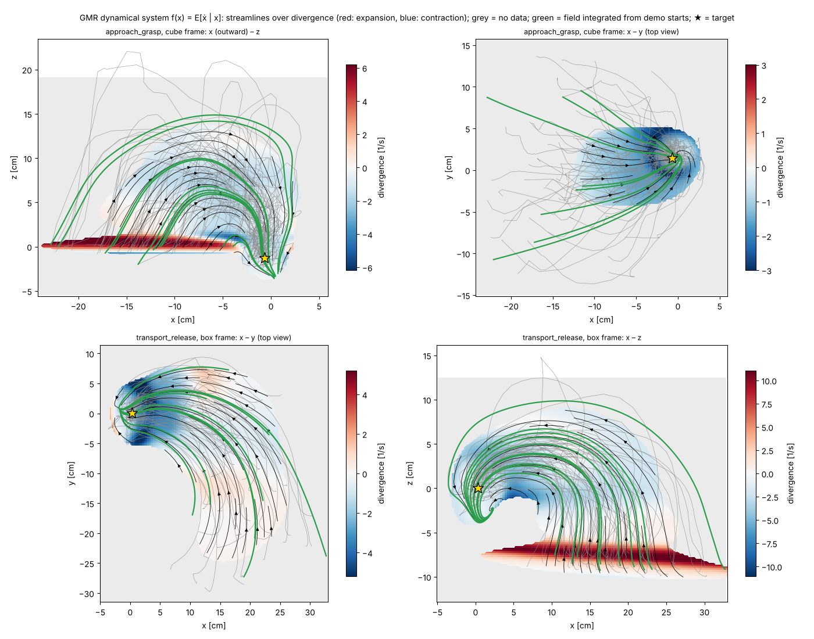

# Learned vector field (GMR dynamical system)

_Generated by `scripts/plot_ds_field.py`._

The TP-GMM of this project is time-indexed: its Gaussians are joint in (t, position) and the regression is on time, so they do not define a vector field. A dynamical system is obtained from the **same demonstrations in the same task frames** by fitting a GMM on [position, velocity] and conditioning on the position: f(x) = E[ẋ | x] (GMR-DS; SEDS is the same model with stability constraints). One 2-D model per panel, K by BIC.

| panel | K | starts converging within 2 cm / 5 cm | median final distance | median divergence within 2 cm of the target |
|---|---|---|---|---|
| approach_grasp, cube frame: x (outward) – z | 10 | 3 % / 100 % | 2.3 cm | -0.93 1/s |
| approach_grasp, cube frame: x – y (top view) | 10 | 100 % / 100 % | 0.7 cm | -1.04 1/s |
| transport_release, box frame: x – y (top view) | 10 | 0 % / 98 % | 2.2 cm | -1.69 1/s |
| transport_release, box frame: x – z | 10 | 0 % / 100 % | 3.0 cm | -1.27 1/s |

**Reading.** Negative divergence (blue) marks where the flow contracts — trajectories from nearby states merge — which is what a reaching motion towards the cube or the box should show near its target. The table checks it by integrating the field from every demonstrated start. Because GMR-DS has no stability constraint, convergence is an empirical property here, not a guarantee: where the integration stops short or drifts, the field has a spurious equilibrium or leaves the data (grey). Enforcing convergence would require SEDS's constrained fit or a stabilizing term (e.g. a Lyapunov-based correction).

**Observations.** In the top views the field funnels every demonstrated start into the target (blue, contracting region around it). In the vertical planes all integrations end within 5 cm but the field's equilibrium sits 2–3 cm from the median target (slightly below the contact point for the approach): with no stability constraint, nothing forces the equilibrium onto the target. The thin horizontal bands of extreme divergence at table height (z ≈ 0 in the cube frame, z ≈ −8 cm in the box frame) are an artifact: there the data form a thin layer (rest and lift-off from the table) across which the vertical velocity changes abruptly, so ∂ż/∂z is large; they are not a real expansion/contraction of the flow.

This field is a diagnostic of what the demonstrations encode as a state-dependent policy; the controller used by the pipeline remains the time-indexed TP-GMM (whose evaluation is in `evaluation_report.md`).
