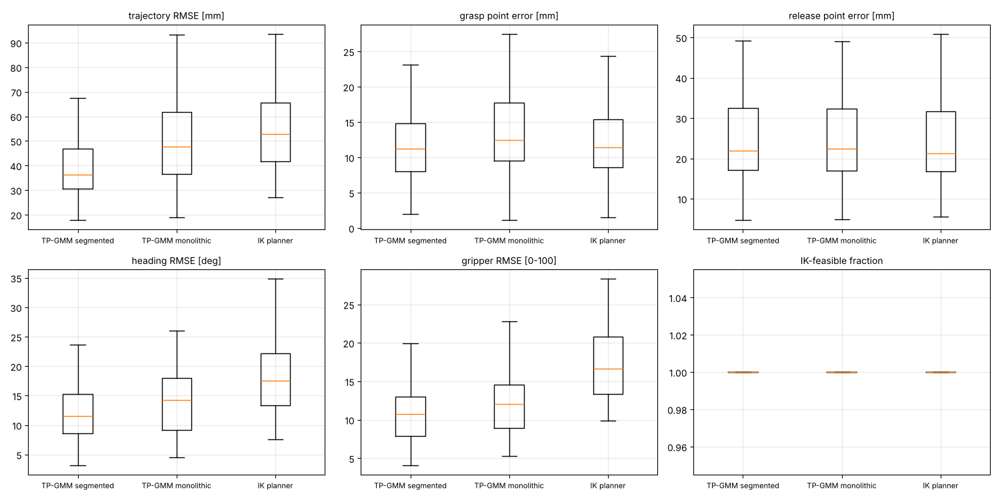
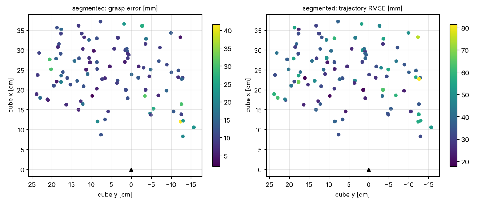

# Offline evaluation (Phase 5): leave-one-out

_Generated by `scripts/evaluate_offline.py`. Raw results: `outputs/evaluation/loo_results.csv` (copy in `docs/evaluation_loo_results.csv`)._

## Protocol

- Held-out cycles: **100** of 366 usable cycles (stratified by colour and lateral position). For each, the three policies are refitted on the remaining cycles and the box frame is re-estimated without the held-out cycle.
- Number of components fixed to the BIC choice on all data: {'approach_grasp': 12, 'transport_release': 12, 'cycle': 12}. The pixel→base homography was also calibrated on all cycles (one correspondence out of ~340 inliers: negligible, but stated).
- Each held-out cycle is generated from its **vision** cube frame (the yaw among the 4 equivalent ones is chosen with the execution rule, not with the demonstration), its start pose and its own primitive durations (time-aligned comparison).
- Metrics: position RMSE over the cycle (200 time-aligned samples); grasp error = predicted TCP at the predicted grasp instant (segmented/planner: end of the approach primitive; monolithic: where its gripper closes) vs the demonstrated contact; release error = end of the cycle vs the demonstrated end of release; IK feasibility = fraction of points with an IK solution inside the joint limits (pitch output used).

## Results (median [IQR])

| model | traj. RMSE [mm] | approach RMSE [mm] | transport RMSE [mm] | grasp err [mm] | grasp err, oracle timing [mm] | release err [mm] | grasp heading err [°] | gripper RMSE |
|---|---|---|---|---|---|---|---|---|
| TP-GMM segmented | 36.4 [30.5, 47.0] | 33.9 [25.3, 40.9] | 36.1 [27.4, 44.8] | 11.2 [8.0, 14.8] | 11.2 [8.0, 14.8] | 21.9 [17.1, 32.5] | 6.7 [2.9, 12.2] | 10.7 [7.9, 13.0] |
| TP-GMM monolithic | 47.6 [36.6, 61.8] | 36.6 [27.8, 50.3] | 59.3 [45.2, 79.0] | 12.4 [9.6, 17.8] | 25.2 [13.9, 66.5] | 22.3 [16.9, 32.4] | 6.9 [3.1, 11.7] | 12.1 [8.9, 14.5] |
| IK planner | 52.8 [41.6, 65.5] | 44.9 [31.3, 57.9] | 53.1 [41.1, 71.4] | 11.5 [8.6, 15.4] | 11.5 [8.6, 15.4] | 21.2 [16.8, 31.6] | 7.0 [2.8, 14.2] | 16.7 [13.3, 20.8] |

| model | IK-feasible fraction (mean) | cycles 100 % feasible | max joint step [°] (median) |
|---|---|---|---|
| TP-GMM segmented | 1.000 | 100 % | 10.6 |
| TP-GMM monolithic | 1.000 | 100 % | 7.6 |
| IK planner | 0.997 | 92 % | 18.7 |

Cube-yaw choice at execution (azimuth + learned offset) matches the demonstrated grasp in **89 %** of held-out cycles; a wrong choice rotates the grasp by 90° (it is still a valid grasp of a cube, but the heading error then counts 90°).

## Reading

Paired comparison on the same held-out cycles (Wilcoxon signed-rank; share of cycles where the segmented model is better):

| metric | segmented vs monolithic | segmented vs IK planner |
|---|---|---|
| trajectory RMSE | p = 5e-16, better in 94 % | p = 2e-16, better in 94 % |
| grasp error | p = 1e-06, better in 71 % | p = 2e-05, better in 69 % |
| release error | p = 0.09, better in 53 % | p = 0.2, better in 44 % |

- **Segmented vs monolithic.** The clearest difference is the trajectory, mostly the transport (36 vs 59 mm RMSE): segmentation aligns every demonstration at the contact instant, so each primitive is learned on consistent phases. At the grasp the gap is smaller (11.2 vs 12.4 mm) because the monolithic model is evaluated where its own gripper closes; its grasp instant is off by 0.48 s (median) from the demonstration, and with the demonstration's contact time its position error is 25 mm — i.e. it reaches the cube, but not when the gripper of a time-indexed controller would expect it.
- **TP-GMM vs IK planner.** Same grasp accuracy within ~1 mm (both use the same cube frame and the planner's contact point is the median of the same data), but the planner's straight segments are far from the demonstrated motion (trajectory RMSE 53 vs 36 mm), its gripper timing is worse, its joint steps are larger, and 8 % of its cycles contain an IK-infeasible point.
- **Release:** no significant difference; all three are bounded by the spread of the demonstrated releases in the box (~2 cm), which the box frame cannot explain (the operator dropped the cube anywhere in it).
- **Cube-yaw choice (90° symmetry):** wrong in 11/100 cycles. There the heading error is 72° (median, vs 5°) and the grasp error doubles (23 vs 10 mm), because the cube frame also orients the approach and contact offset. These grasps are still physically valid (rotated by 90°), but they differ from what the operator did; a better rule (e.g. the yaw closest to the current wrist heading, or the one with the smallest wrist rotation) is the most direct improvement.
- **Error floors:** the grasp error is bounded below by the vision error (~8 mm median vs FK, `vision_report.md`) and by how consistently the operator grasped. Large errors are more frequent on the robot's right side close to the base (`eval_by_position.png`), where vision is also least accurate and cubes were pushed more often, but they also occur elsewhere.
