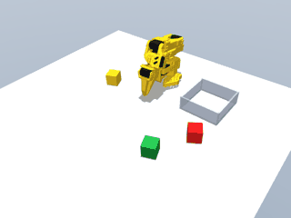

# Grasp verification and replanning (MuJoCo, `segmented`)

_Generated by `scripts/eval_grasp_replan.py`. Three random cubes per episode, contact physics, the real follower's gripper command (squeeze while holding); the same layouts and perception-noise draws for both arms. **Open loop**: the plan is executed without checking the grasp (as `so101_runner` does). **Verified**: the grasp is checked and a missed cube is re-detected and planned again._

## Delivered cubes

| perception noise σ | open loop: delivered | verified + replan: delivered | open loop: in box | verified: in box | verified: attempts per cube (mean) | cubes needing a replan |
|---|---|---|---|---|---|---|
| 0 mm | 98 % (88/90) | **98 %** (88/90) | 77 % | 77 % | 1.08 | 4 |
| 8 mm | 78 % (70/90) | **99 %** (89/90) | 71 % | 84 % | 1.23 | 17 |
| 15 mm | 50 % (45/90) | **81 %** (73/90) | 49 % | 76 % | 1.77 | 44 |
| 25 mm | 29 % (26/90) | **49 %** (44/90) | 29 % | 47 % | 2.31 | 66 |

## Detector against the simulator's ground truth

575 grasp checks (all noise levels). Ground truth: the cube is more than 2 cm above where it was at the check (it is being lifted).

| | truly held | truly missed |
|---|---|---|
| detected held | 289 | 0 |
| detected missed | 16 | 270 |

Measured − commanded gripper at the check: held median 21.8 (min 0.0), missed median 0.0 (max 0.8); threshold `grasp_check.min_margin`.

No missed grasp was taken as held. The 16 checks *detected missed* while the cube was rising had the jaws (nearly) closed (measured gripper 2.5–10.0): the cube was carried on a finger tip or caught by a corner, not pinched between the jaws. Releasing it and planning again is the conservative choice; the held verdicts had a margin of at least 9.6.

## The signals (real data)

Measured on dataset3 (`so101_tpgmm/grasp.py`):

| signal | holding a cube | gripper closed empty | threshold |
|---|---|---|---|
| follower − leader gripper | median 19.1 (399 cycles) | 0.5 s after closing: median 0.7, max 6.6 (398); 0.17 s after: up to 41 (jaws still moving) | `min_margin` 8, checked `settle_s` 0.5 s after the command reaches its hold value |
| the three demonstrations with a missed grasp | — | −0.8, 0.7, −0.2 | |
| wrist camera: largest cube-coloured blob / ROI | 0.5 s after closing: median 0.55, min 0.32; 1.3 s: median 0.54, 2 of 79 below 0.25 | after the release: 0.00 (79 of 79) | `wrist.min_blob` 0.15 |

On the robot the executor sends the squeeze command (`inference.gripper_command.hold_command`, 2): a held cube keeps the jaws near 20, an empty gripper reaches ~2.

## Notes

- The re-detection draws a new perception error, independent of the first one. The real camera's error is partly a bias that repeats from photo to photo (calibration), so on the robot a replan from the same camera can repeat the same miss: the gain here is an upper bound for that part of the error.
- A cube knocked into the box or off the table during a miss is not attempted again.
- Signals and thresholds: `so101_tpgmm/grasp.py` (measured on dataset3 and in MuJoCo).
