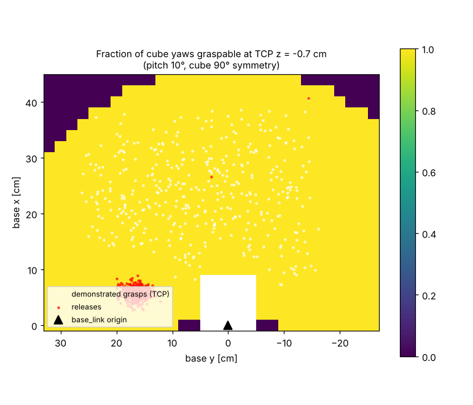

# Kinematics report (Phase 1)

_Generated by `scripts/check_kinematics.py`._

## Definitions

- **FK:** URDF `so101_new_calib.urdf`, chain `base_link → gripper_frame_link`, radians (dataset degrees converted explicitly).
- **Wrist yaw:** heading on the table of the TCP x axis, which is the jaw-closing direction (the moving jaw rotates about TCP y; TCP z is the approach axis, pointing down when grasping).
- **Approach pitch:** tilt of TCP z from straight down, positive when leaning radially outward. For a 5-DOF arm the approach axis always lies in the vertical plane through the arm (measured tangential component ≈ 0), so position + yaw leave exactly this one DOF free.
- **Joint limits:** union of URDF and observed range (+1.0°): shoulder_pan [-110.0, 110.0]°, shoulder_lift [-106.1, 100.0]°, elbow_flex [-96.8, 97.9]°, wrist_flex [-95.0, 102.8]°, wrist_roll [-157.2, 162.8]°.
- **Success:** position error ≤ 1.0 mm, yaw error ≤ 1.0°, inside limits, yaw defined at the solution. Otherwise the target is flagged — never clipped.

## Solver

Seeds come first from the **closed-form decoupling IK** (`kinematics/analytic.py`, the corrected model of Rivas 2026, see `kinematics_paper_review.md`): both elbow branches, filtered by joint limits, closest to the previous posture first. Then bounded least squares (`scipy` TRF) with the analytic geometric Jacobian (checked against finite differences in the tests). Two stages: (1) position + yaw + **soft pitch target** choose the posture; (2) task-priority polish drives position/yaw error to zero from there. Seeds point the pan at the target and set the roll from the requested yaw; restarts are tried only if needed. Trajectories are solved with warm starts (each solution seeds the next and regularizes the redundant DOF).

## FK → IK round trips (random task-relevant configurations)

TCP in front of the robot (x > 3 cm), −1 cm < z < 25 cm, |pitch| < 60°, yaw defined.

| pitch | targets | success | same joints (< 1°) | ms / solve |
|---|---|---|---|---|
| demonstrated pitch | 300 | 100.0 % | 84 % | 11 |
| default pitch | 300 | 99.3 % | 2 % | 15 |

Without the true pitch the solver finds *a* valid posture (task exact) but not necessarily the original joints: that is the redundant DOF.

## Recorded trajectories (30 episodes, every 3rd frame, 5985 targets)

| pitch | feasible (mean / min per episode) | max \|q − q_recorded\| (median / max) | max joint step | ms / point |
|---|---|---|---|---|
| demonstrated pitch | 99.9 % / 98.5 % | 0.5° / 35.9° | 26.2° | 7.5 |
| default pitch | 100.0 % / 99.0 % | 59.1° / 99.5° | 68.0° | 7.6 |

- With the demonstrated pitch, IK reproduces the recorded joint trajectories (the human postures).
- With a fixed default pitch the TCP path is still exact, but the posture can differ by tens of degrees, mostly near the folded rest pose where a small pitch change needs a very different folding. **Design consequences:** (a) the return to home is executed in joint space, not in Cartesian space; (b) Phase 4 should also regress the approach pitch (one extra GMR output) so IK can follow the demonstrated posture.

## Reachable workspace on the table

Grid step 2 cm at TCP z = -0.7 cm (median demonstrated grasp height), pitch 10°. A cube with yaw φ is graspable if any gripper yaw φ + k·90° is feasible.

- Demonstrated grasps: 99.7 % lie where all cube yaws are graspable, 99.7 % where at least one is.
- Positions outside the map (or partially graspable) are a **silent failure** for inference: `infer.py` must check IK feasibility of each target before execution and report the cube as unreachable rather than clip it.
