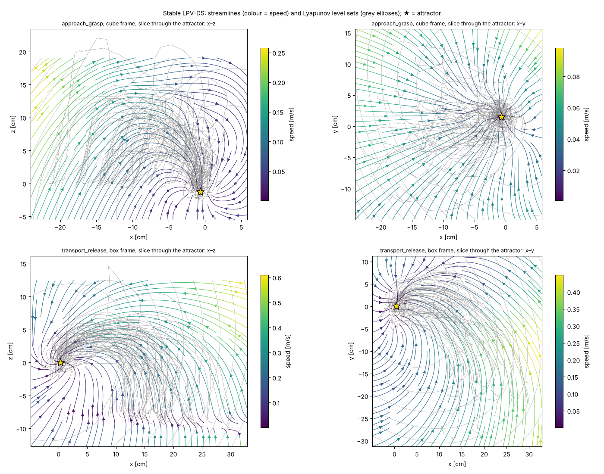
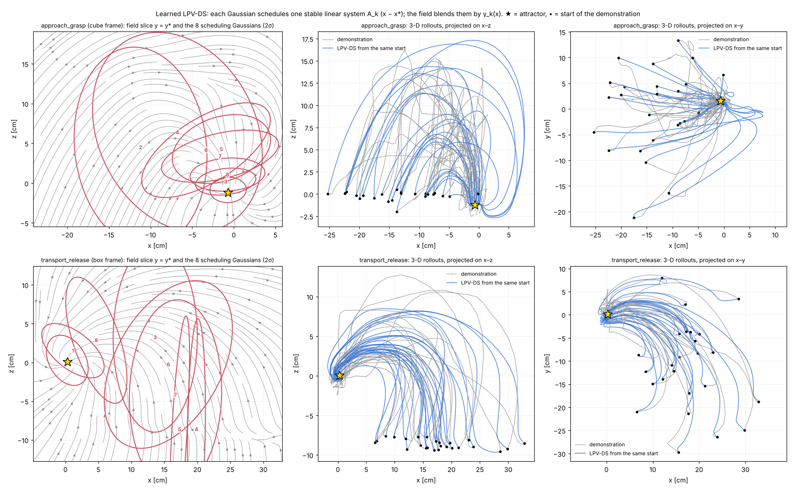

# LPV-DS policy

_Generated by `scripts/train_lpvds.py`._

## Model

ẋ = Σ_k γ_k(x) A_k (x − x*) per primitive, in its goal frame (approach: cube; transport: box). Stability is built into the parameterization: P = QQᵀ + εI, A_k = P⁻¹B_k with B_k + B_kᵀ = −2(L_kL_kᵀ + εI) ≺ 0, so V = (x − x*)ᵀP(x − x*) decreases for any fitted parameters (no SDP solver needed). Scheduling GMM on [position, scaled velocity direction] (a lightweight physically-consistent clustering); K by BIC. Heading and pitch: stable scalar DS with the same γ(x). Gripper: E[g | distance to the attractor], held open within 2 cm and closed on arrival. Speed: positive state-dependent scaling (floor near the target, ceiling at the 99th percentile), which keeps the flow direction and hence stability.

| primitive | K | max eig(AᵀP + PA) | velocity RMSE [m/s] | demo starts converging (< 2 mm) | speed floor / ceiling [m/s] |
|---|---|---|---|---|---|
| approach_grasp | 8 | -0.0020 | 0.088 | 100 % | 0.025 / 0.310 |
| transport_release | 8 | -0.0020 | 0.131 | 100 % | 0.048 / 0.585 |

Scheduling Gaussians and 3-D rollouts from demonstrated starts vs the demonstrations (`scripts/plot_lpvds.py`):

The velocity RMSE stays large relative to the demonstrated speeds: the field reproduces the arched approach through its rotational part (figure), but it assigns one velocity to each position, while the demonstrations cross the same regions with different velocities (different operators' paces and phases). What the model guarantees instead is convergence to the attractor from anywhere, and a reaction to the current state. Offline comparison: `evaluation_report.md`; robustness: `perturbation_report.md`.

**Path shape.** In ~18 % of nominal approaches the field carries the arm past the cube (more than 2 cm, outward) and down from the far side (`perturbation_report.md`). Penalizing the rotational (skew) part of A_k in the fit was tried: it reduces the worst cases (p90 overshoot 7.1 → 4.3 cm) but not their share (~20 %), at a small cost in velocity fit, so it was not adopted. Shaping the approach direction would need extra structure (e.g. a via-point / funnel near the cube, or a non-quadratic Lyapunov function).
