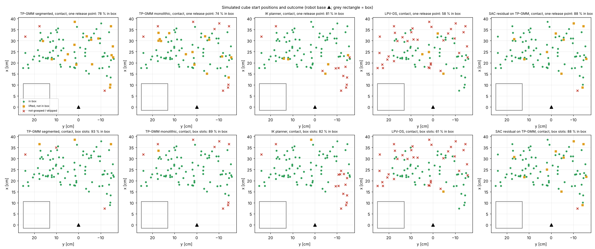
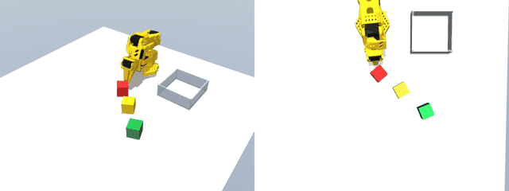
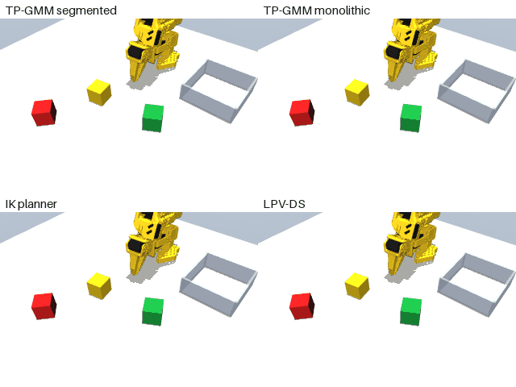
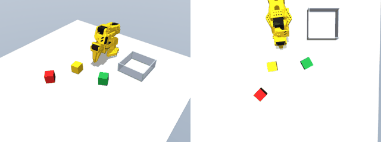

# MuJoCo simulation of the learned policies

_Generated by `scripts/simulate_mujoco.py`._

## Setup

- **Robot:** official SO-101 MJCF (TheRobotStudio/SO-ARM100, Apache-2.0), same CAD as our URDF: its TCP site matches our FK to < 4 µm. Position servos with the model's STS3215 gains and torque limit (3.35 N·m), commands at 30 Hz in LeRobot units (degrees, gripper 0-100 mapped linearly to the jaw range).
- **Fingers:** the convex hulls of the jaw meshes fill the gap between the fingers (they overlap at every opening), so each finger is replaced by boxes fitted to 1 cm slices of its mesh. With the linear gripper map the tips touch at 0 and are 4 cm apart at ~26: the demonstrated holding command (~20) squeezes the cube.
- **Table:** the plane on which the fingers rested at the demonstrated grasps, in FK coordinates (z = -0.0112 -0.059·x +0.004·y m). The real table is flat; in FK coordinates it looks tilted by ~3.4° and 2.5 cm lower than the tape-grid estimate — the joint-calibration error of the real arm. The simulation is consistent with the commanded joints, which is what matters here.
- **Box:** open container 12×12 cm inside, 4.5 cm high, centred at (4.5, 19.0) cm. **Not measured**: sized to hold every demonstrated release and to stay clear of every demonstrated grasp.
- **Cubes:** 3 per episode (red, yellow, green), 4 cm, 30 g (not measured), friction 1.2; positions = a demonstrated cube position + a uniform disc of 2 cm (the trained workspace), ≥ 8 cm apart and clear of the box; yaw uniform. Picked in the order red, yellow, green, blue. Every policy sees the same layouts.
- **Known position, in the policy's convention.** The camera-based cube positions the policies were trained with are biased by ~2 cm with respect to the fingers of the FK model. Handing the policies the physical cube centre would test that calibration bias, not the policy. The position given to each policy is the one that makes *its own* nominal grasp centre the fingers on the cube with the finger tips 1 cm above the table (a few fixed-point iterations on its rollout), i.e. a perfectly calibrated perception.
- **Pipeline per cube:** measured joints → policy rollout → IK (pitch soft target; a cube with any unreachable point is skipped) → joint trajectory → return home (joint space, 2 s). Open loop: the plan is not corrected during execution (also for the LPV-DS, which is integrated from the measured start).
- **Grasp modes:** `contact` = pure physics. `assist` = a cube touched by both fingers is attached while the gripper is closed; the approach still has to place the cube between the fingers. It isolates the policy from the unmeasured friction / mass / pad compliance.
- **Release:** *one release point* = the policies as trained (the box never moved in the demonstrations, and each demonstration had a single cube): every cube is released at the same place. *Box slots* = the k-th cube is released with the policy's box frame shifted by `sim.box_slots[k]` (landing points ≥ 5.5 cm apart): the task parameter is changed at execution, without retraining.

## Results

30 episodes × 3 cubes per policy and condition, same layouts for all. *Delivered* = released over the box while still held, or inside it at the end (a tower that falls over still counts: the task is to bring the cubes to the box). *In box* = inside the walls at the end (resting on another cube counts).

| release | grasp mode | policy | delivered | in box at the end | cubes lifted | skipped (IK) | episodes with all cubes in box | cycle time [s] |
|---|---|---|---|---|---|---|---|---|
| one point | contact | TP-GMM segmented | 96 % | 78 % | 97 % | 0 % | 37 % | 6.8 |
| one point | contact | TP-GMM monolithic | 89 % | 74 % | 90 % | 0 % | 33 % | 6.9 |
| one point | contact | IK planner | 87 % | 81 % | 87 % | 11 % | 50 % | 6.8 |
| one point | contact | LPV-DS | 61 % | 58 % | 62 % | 2 % | 7 % | 7.8 |
| one point | contact | SAC residual on TP-GMM | 99 % | 88 % | 99 % | 0 % | 63 % | 6.5 |
| one point | assist | TP-GMM segmented | 99 % | 94 % | 99 % | 0 % | 87 % | 6.8 |
| one point | assist | TP-GMM monolithic | 91 % | 72 % | 91 % | 0 % | 30 % | 6.9 |
| one point | assist | IK planner | 88 % | 82 % | 88 % | 11 % | 50 % | 6.8 |
| one point | assist | LPV-DS | 72 % | 68 % | 72 % | 2 % | 20 % | 7.8 |
| one point | assist | SAC residual on TP-GMM | 99 % | 91 % | 100 % | 0 % | 73 % | 6.6 |
| box slots | contact | TP-GMM segmented | 94 % | 93 % | 97 % | 0 % | 80 % | 6.8 |
| box slots | contact | TP-GMM monolithic | 89 % | 89 % | 90 % | 0 % | 70 % | 6.9 |
| box slots | contact | IK planner | 83 % | 82 % | 83 % | 14 % | 50 % | 6.8 |
| box slots | contact | LPV-DS | 61 % | 61 % | 62 % | 2 % | 17 % | 7.8 |
| box slots | contact | SAC residual on TP-GMM | 99 % | 88 % | 99 % | 0 % | 63 % | 6.5 |
| box slots | assist | TP-GMM segmented | 98 % | 97 % | 98 % | 0 % | 90 % | 6.8 |
| box slots | assist | TP-GMM monolithic | 90 % | 90 % | 90 % | 0 % | 70 % | 6.9 |
| box slots | assist | IK planner | 84 % | 82 % | 84 % | 14 % | 53 % | 6.8 |
| box slots | assist | LPV-DS | 74 % | 74 % | 74 % | 2 % | 37 % | 7.8 |
| box slots | assist | SAC residual on TP-GMM | 99 % | 91 % | 100 % | 0 % | 73 % | 6.6 |

Example episodes (left: perspective; right: overhead, like the fixed camera; MP4 next to each GIF):

`sim_lpv_ds_contact_slots_seed1`

`sim_montage_seed0`

`sim_segmented_contact_slots_seed0`

## Reading

- **Delivered to the box** (towers allowed; contact physics, policies as trained): SAC residual on TP-GMM 99 %, TP-GMM segmented 96 %, TP-GMM monolithic 89 %, IK planner 87 %, LPV-DS 61 %.
- **Best policy: TP-GMM segmented**: 91 % of the cubes in the box on average over the 4 noise-free conditions, best in 3 of them; from 78 % (contact physics, policies as trained) to 97 % (box slots, grasp assist). Average of the others: SAC residual on TP-GMM 89 %, IK planner 82 %, TP-GMM monolithic 81 %, LPV-DS 65 %.
- **LPV-DS grasps fewer cubes** (lifted 62 % vs 97 % for the segmented TP-GMM) although its grasp point is as accurate: the rest pose puts the gripper at table height a few cm from the robot, and a first-order field of the position, started there, heads for the cube almost horizontally with the jaws still closed (they open only near the cube), sweeping or pushing it, where the time-indexed TP-GMM reproduces the operator's lift-then-approach. The offline evaluation, which scores the grasp point and the path shape, could not show what the arm hits on the way.
- **IK planner:** 11 % of the cubes are skipped because a point of its straight-segment path is unreachable (the TP-GMM paths, learned from feasible demonstrations, never are).
- **Monolithic TP-GMM:** lifted 90 % vs 97 % for the segmented model, consistent with the offline finding that, without the primitive boundary, its gripper closes ~0.5 s away from the demonstrated contact (`evaluation_report.md`).
- **SAC residual vs TP-GMM** (same layouts, contact, one release point): delivered 99 vs 96 %, in the box 88 vs 78 % (residual better on 15 cubes, worse on 6; p = 0.078); with grasp assist the difference reverses: equivalent within these 90 cubes. The residual ignores box slots (it observes a fixed release point), hence its unchanged numbers with slots.
- **One release point vs box slots:** with every cube released at the same spot they pile up and some fall out; shifting the box frame per cube (a task parameter changed at execution, never varied in the demonstrations) changes the cubes in the box by TP-GMM segmented +16 pts, TP-GMM monolithic +14 pts, IK planner +1 pts, LPV-DS +3 pts, SAC residual on TP-GMM +0 pts.
- **Grasp assist** (removes slipping, not approach errors): TP-GMM segmented +3 pts, TP-GMM monolithic +1 pts, IK planner +0 pts, LPV-DS +13 pts, SAC residual on TP-GMM +3 pts (box slots). What remains with assist is the approach.
- **Perception noise σ = 8 mm** (box slots, assist): TP-GMM segmented 97 → 87 %, TP-GMM monolithic 90 → 82 %, IK planner 82 → 70 %, LPV-DS 74 → 68 %, SAC residual on TP-GMM 91 → 80 %. With the real camera (~8 mm median error) the success would drop accordingly: better calibration pays off as much as a better policy.

### Perception noise

Gaussian noise added to the known cube position (xy, per axis), as a stand-in for the vision error of the real pipeline (~8 mm median vs FK):

| release | grasp mode | policy | noise σ [mm] | cubes in box | cubes lifted |
|---|---|---|---|---|---|
| one point | contact | TP-GMM segmented | 0 | 78 % | 97 % |
| one point | contact | TP-GMM segmented | 8 | 69 % | 80 % |
| one point | contact | TP-GMM monolithic | 0 | 74 % | 90 % |
| one point | contact | TP-GMM monolithic | 8 | 71 % | 78 % |
| one point | contact | IK planner | 0 | 81 % | 87 % |
| one point | contact | IK planner | 8 | 66 % | 72 % |
| one point | contact | LPV-DS | 0 | 58 % | 62 % |
| one point | contact | LPV-DS | 8 | 41 % | 49 % |
| one point | contact | SAC residual on TP-GMM | 0 | 88 % | 99 % |
| one point | contact | SAC residual on TP-GMM | 8 | 70 % | 84 % |
| one point | assist | TP-GMM segmented | 0 | 94 % | 99 % |
| one point | assist | TP-GMM segmented | 8 | 80 % | 83 % |
| one point | assist | TP-GMM monolithic | 0 | 72 % | 91 % |
| one point | assist | TP-GMM monolithic | 8 | 71 % | 79 % |
| one point | assist | IK planner | 0 | 82 % | 88 % |
| one point | assist | IK planner | 8 | 71 % | 78 % |
| one point | assist | LPV-DS | 0 | 68 % | 72 % |
| one point | assist | LPV-DS | 8 | 64 % | 67 % |
| one point | assist | SAC residual on TP-GMM | 0 | 91 % | 100 % |
| one point | assist | SAC residual on TP-GMM | 8 | 80 % | 87 % |
| box slots | contact | TP-GMM segmented | 0 | 93 % | 97 % |
| box slots | contact | TP-GMM segmented | 8 | 80 % | 82 % |
| box slots | contact | TP-GMM monolithic | 0 | 89 % | 90 % |
| box slots | contact | TP-GMM monolithic | 8 | 79 % | 80 % |
| box slots | contact | IK planner | 0 | 82 % | 83 % |
| box slots | contact | IK planner | 8 | 62 % | 69 % |
| box slots | contact | LPV-DS | 0 | 61 % | 62 % |
| box slots | contact | LPV-DS | 8 | 43 % | 48 % |
| box slots | contact | SAC residual on TP-GMM | 0 | 88 % | 99 % |
| box slots | contact | SAC residual on TP-GMM | 8 | 70 % | 84 % |
| box slots | assist | TP-GMM segmented | 0 | 97 % | 98 % |
| box slots | assist | TP-GMM segmented | 8 | 87 % | 87 % |
| box slots | assist | TP-GMM monolithic | 0 | 90 % | 90 % |
| box slots | assist | TP-GMM monolithic | 8 | 82 % | 82 % |
| box slots | assist | IK planner | 0 | 82 % | 84 % |
| box slots | assist | IK planner | 8 | 70 % | 74 % |
| box slots | assist | LPV-DS | 0 | 74 % | 74 % |
| box slots | assist | LPV-DS | 8 | 68 % | 69 % |
| box slots | assist | SAC residual on TP-GMM | 0 | 91 % | 100 % |
| box slots | assist | SAC residual on TP-GMM | 8 | 80 % | 87 % |

## Failure modes

Cubes not in the box, by cause (counts):

| release | grasp mode | policy | dropped in transport | not grasped | released over the box, fell out | skipped (IK) |
|---|---|---|---|---|---|---|
| box slots | assist | IK planner | 0 | 1 | 2 | 13 |
| box slots | assist | LPV-DS | 0 | 21 | 0 | 2 |
| box slots | assist | SAC residual on TP-GMM | 1 | 0 | 7 | 0 |
| box slots | assist | TP-GMM monolithic | 0 | 9 | 0 | 0 |
| box slots | assist | TP-GMM segmented | 0 | 2 | 1 | 0 |
| box slots | contact | IK planner | 0 | 2 | 1 | 13 |
| box slots | contact | LPV-DS | 1 | 32 | 0 | 2 |
| box slots | contact | SAC residual on TP-GMM | 0 | 1 | 10 | 0 |
| box slots | contact | TP-GMM monolithic | 1 | 9 | 0 | 0 |
| box slots | contact | TP-GMM segmented | 2 | 3 | 1 | 0 |
| one point | assist | IK planner | 0 | 1 | 5 | 10 |
| one point | assist | LPV-DS | 0 | 23 | 4 | 2 |
| one point | assist | SAC residual on TP-GMM | 1 | 0 | 7 | 0 |
| one point | assist | TP-GMM monolithic | 0 | 8 | 17 | 0 |
| one point | assist | TP-GMM segmented | 0 | 1 | 4 | 0 |
| one point | contact | IK planner | 0 | 2 | 5 | 10 |
| one point | contact | LPV-DS | 1 | 32 | 3 | 2 |
| one point | contact | SAC residual on TP-GMM | 0 | 1 | 10 | 0 |
| one point | contact | TP-GMM monolithic | 1 | 9 | 13 | 0 |
| one point | contact | TP-GMM segmented | 1 | 3 | 16 | 0 |

## Limits

- Kinematic and contact model only as good as its parameters: cube mass and friction, pad compliance and the box were not measured; the gripper map (0-100 → jaw angle) is linear between the joint limits.
- Open-loop execution of each plan, as in `scripts/infer.py` (no visual feedback while moving).
- The perception is ideal (or Gaussian noise with `--noise-mm`): no occlusions, no detection failures.
- Replaying the human demonstrations in the simulator is not a validation of the policies: the initial cube pose of the demonstrations is known only to ~1 cm and the operator sometimes nudged the cube.

