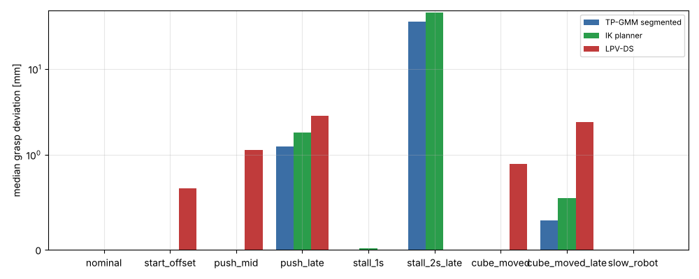
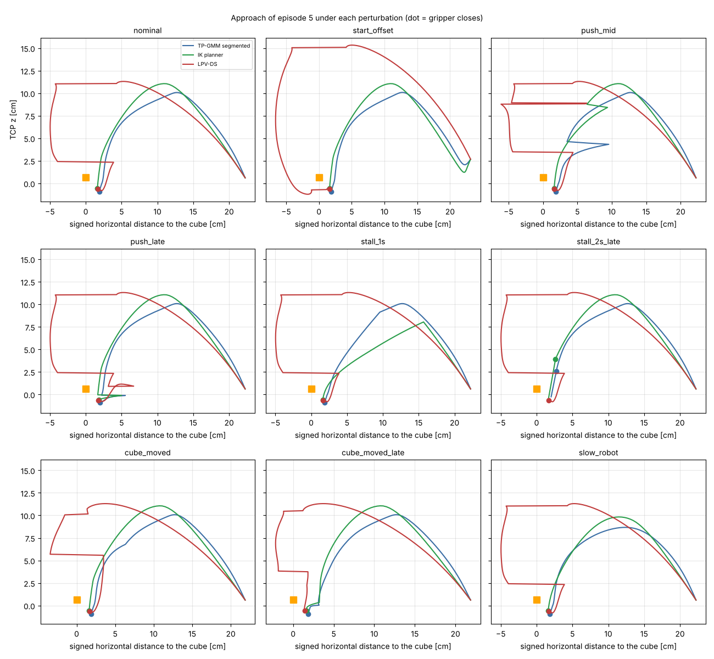

# Perturbation benchmark: time-indexed TP-GMM vs LPV-DS

_Generated by `scripts/perturbation_benchmark.py`. Raw results: `outputs/evaluation/perturbation.csv`._

## Setup

- 80 cycles (stratified), approach_grasp primitive, kinematic TCP simulation at 30 Hz. All controllers share the speed limit 0.31 m/s (99th percentile of demonstrated approach speeds).
- Time-indexed controllers track their reference with u = ṙ(t) + Kp(r(t) − x), Kp = 5.0 1/s; the gripper follows the reference's time profile. LPV-DS: u = f(x); gripper from the distance to the attractor.
- Scenarios, timed at the same phase of each controller's own nominal approach (median demonstrated approach 4.3 s): start offset 5 cm (random direction, partly upwards); push 4 cm (horizontal) at 50 % (`push_mid`) or 85 % (`push_late`) of the approach; stall 1 s at 30 % (`stall_1s`) or 2 s at 60 % (`stall_2s_late`); cube moved 3 cm at 40 % or 80 % with the new frame given to every controller (time-indexed ones replan the rest of their reference); `slow_robot`: the arm can only reach 40 % of the speed limit (load, low gains, a slower robot than the demonstrator's). The late variants leave the time-indexed reference little or no time to recover. LPV-DS arrival tolerance {args.ds_tolerance * 1e3:.0f} mm.
- **Grasp deviation**: TCP position when the gripper closes vs the grasp point of the same controller without perturbation (final cube pose). Success: < 10 mm. Models trained on all usable cycles (this is a robustness test, not a generalization test).

## Results

| scenario | controller | grasp deviation median [mm] | p90 [mm] | success | time to grasp [s] | peak commanded speed [m/s] |
|---|---|---|---|---|---|---|
| nominal | TP-GMM segmented | 0.0 | 0.0 | 100 % | 4.23 | 0.23 |
| nominal | IK planner | 0.0 | 0.0 | 100 % | 3.73 | 0.16 |
| nominal | LPV-DS | 0.0 | 0.0 | 100 % | 4.17 | 0.10 |
| start_offset | TP-GMM segmented | 0.0 | 0.0 | 100 % | 4.23 | 0.25 |
| start_offset | IK planner | 0.0 | 0.0 | 100 % | 3.73 | 0.25 |
| start_offset | LPV-DS | 0.6 | 2.9 | 100 % | 4.28 | 0.11 |
| push_mid | TP-GMM segmented | 0.0 | 0.0 | 100 % | 4.23 | 0.37 |
| push_mid | IK planner | 0.0 | 0.0 | 100 % | 3.73 | 0.23 |
| push_mid | LPV-DS | 1.1 | 3.4 | 100 % | 4.65 | 0.10 |
| push_late | TP-GMM segmented | 1.3 | 1.3 | 100 % | 4.23 | 0.23 |
| push_late | IK planner | 1.8 | 1.8 | 100 % | 3.73 | 0.20 |
| push_late | LPV-DS | 2.9 | 42.0 | 80 % | 4.68 | 0.10 |
| stall_1s | TP-GMM segmented | 0.0 | 0.0 | 100 % | 4.23 | 0.39 |
| stall_1s | IK planner | 0.0 | 0.1 | 100 % | 3.73 | 0.55 |
| stall_1s | LPV-DS | 0.0 | 0.0 | 100 % | 5.17 | 0.10 |
| stall_2s_late | TP-GMM segmented | 35.3 | 37.2 | 0 % | 4.23 | 0.23 |
| stall_2s_late | IK planner | 45.6 | 45.9 | 0 % | 3.73 | 0.23 |
| stall_2s_late | LPV-DS | 0.0 | 0.0 | 100 % | 6.17 | 0.10 |
| cube_moved | TP-GMM segmented | 0.0 | 0.0 | 100 % | 4.23 | 0.23 |
| cube_moved | IK planner | 0.0 | 0.0 | 100 % | 3.73 | 0.17 |
| cube_moved | LPV-DS | 0.9 | 3.0 | 100 % | 4.22 | 0.10 |
| cube_moved_late | TP-GMM segmented | 0.3 | 0.3 | 100 % | 4.23 | 0.23 |
| cube_moved_late | IK planner | 0.5 | 0.6 | 100 % | 3.73 | 0.16 |
| cube_moved_late | LPV-DS | 2.4 | 3.6 | 92 % | 4.65 | 0.10 |
| slow_robot | TP-GMM segmented | 0.0 | 0.0 | 100 % | 4.23 | 0.31 |
| slow_robot | IK planner | 0.0 | 0.0 | 100 % | 3.73 | 0.21 |
| slow_robot | LPV-DS | 0.0 | 0.2 | 100 % | 4.18 | 0.10 |

