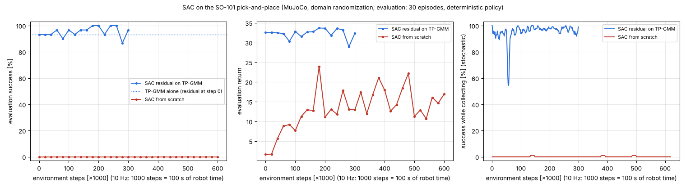

# SAC on the SO-101 pick-and-place

_Generated by `scripts/eval_sac.py` (training: `scripts/train_sac.py`)._

## Setup

- **Environment** (`so101_tpgmm/rl/`): the MuJoCo scene of `mujoco_sim.md` (official SO-101 model, finger boxes, table plane in FK coordinates, contact physics, 0.5 ms steps), one cube per episode drawn from the demonstrated workspace. The agent acts at 10 Hz; each action becomes a TCP target → IK (warm-started, joint rate limit) → joint commands interpolated at 30 Hz to the position servos, as on the robot.
- **Observation** (25/31-D, all available on the real robot): measured joints and gripper, TCP and heading by FK, cube pose from one camera snapshot at the start (no tracking), release point, commanded target, time; residual: also the TP-GMM's current target and heading.
- **Actions**: *from scratch*: Δxyz (≤ 2 cm per step), Δheading (≤ 15°), gripper command. *Residual*: offsets added to the TP-GMM plan (≤ 1 cm, ≤ 8°); the gripper follows the TP-GMM (see *Residual: what went wrong first*). Zero action = the TP-GMM.
- **Reward** (staged, robosuite-like): reach 0.1·(1 − tanh 10d), grasp 0.35, lift/carry 0.35–0.5, success = cube released inside the box → 1 per remaining step (the episode ends); −0.05 for an unreachable target; residual: −0.2·mean(a²).
- **Domain randomization** per episode: table height ±4 mm, cube mass 20–60 g, friction 0.8–1.5, servo stiffness ±20 %, perception noise 3 mm / 3°.
- **SAC** (Stable-Baselines3): 256×256 networks, γ = 0.98, batch 256, 2 parallel environments. Residual: zero-initialized mean (starts as the TP-GMM), exploration σ = 0.2, critic-only warm-up of 50 k steps, actor learning rate ×0.1, fixed entropy coefficient 0.002, 2 updates per step.

## Learning curves

## Evaluation (single cube, deterministic policies, same seeds)

| condition | policy | success [95 % CI] | cube lifted | mean time [s] | episodes |
|---|---|---|---|---|---|
| nominal | TP-GMM alone | 95.5 % [92, 98] | 96 % | 6.4 | 200 |
| nominal | SAC residual on TP-GMM | 96.5 % [93, 98] | 98 % | 6.5 | 200 |
| nominal | SAC from scratch | 0.0 % [0, 2] | 12 % | nan | 200 |
| noise8 | TP-GMM alone | 78.5 % [72, 84] | 82 % | 6.4 | 200 |
| noise8 | SAC residual on TP-GMM | 81.5 % [76, 86] | 84 % | 6.5 | 200 |
| noise8 | SAC from scratch | 0.0 % [0, 2] | 11 % | nan | 200 |

- **nominal:** SAC residual succeeds where the TP-GMM fails in 2 episodes, and the opposite in 0 (exact binomial test on the discordant pairs, p = 0.5).
- **noise8:** SAC residual succeeds where the TP-GMM fails in 11 episodes, and the opposite in 5 (exact binomial test on the discordant pairs, p = 0.21).

## Reading

- **SAC residual ≈ TP-GMM.** 96.5 vs 95.5 % (nominal) and 81.5 vs 78.5 % (8 mm perception noise): slightly better, not significantly. It keeps the TP-GMM's success, which the first attempts did not, but adds little. The TP-GMM's failures grow with the perception error (4.5 → 21.5 %), and the residual observes the same single camera snapshot, so it cannot know where the cube really is. To correct them it needs information the TP-GMM does not use: the cube re-detected during the approach (fixed camera when not occluded, or a wrist camera), or contact/gripper feedback.
- **SAC from scratch: 0 %** with its best checkpoint so far (it reaches the cube and lifts it in ~10 % of the episodes, but does not bring it to the box yet); see the learning curve for the run length.
- **TP-GMM + residual is the practical path to the real robot**: it starts from a working policy, never explores far from it, and can keep learning on real episodes (`scripts/run_sac_real.py --finetune`).

## Residual: what went wrong first

1. **Initial exploration noise.** In SB3, `log_std_init` only applies with gSDE; without it the initial σ is ~1 and the noise alone broke the TP-GMM (4 % success while collecting, 93 % deterministic). Fixed by initializing the log-σ layer.
2. **Actor jumps after the warm-up.** With σ = 0.05, a 30 k critic warm-up and the full learning rate, the actor moved to corrections the critic had never seen: 93 % → 33 %. A slower actor (×0.1) and wider exploration were not enough on their own (93 % → 53 %).
3. **A cliff in the gripper dimension.** A constant +9 gripper units while holding leaves the jaws wider than the cube (2/20 successes vs 20/20); ±1 cm in position costs much less (11–19/20). Letting the gripper follow the TP-GMM, with finer position/heading corrections, a fixed entropy coefficient and a larger action penalty, made the residual stable (dip to 55 % while collecting at the end of the warm-up, back to 92–96 %).

## SAC from scratch

Same environment and reward, no prior. See the learning curve: pick-and-place from scratch with a staged reward and 10 Hz control needs on the order of 10⁶ steps (≈ 28 h of robot time), which is why, on the real robot, only the residual variant (or fine-tuning a simulation policy) is realistic.

## On the real robot

`scripts/run_sac_real.py` runs the same observation/action loop on the SO-101 (`so101_tpgmm/rl/real_env.py`): cube from the fixed camera, converted to the finger-midpoint convention of the simulation (`rl.vision_to_finger_heading_mm`, measured on the 368 demonstrated grasps), joint commands at 30 Hz with LeRobot's per-command limit, tracking-error abort, operator-labelled success; `--finetune N` keeps training on real episodes, with a measurable grasp reward (jaws stopped open by the cube).

Runs: `residual_attempt1`, `residual_attempt2`, `residual_s0`, `scratch_s0` (in `outputs/models/sac`, not versioned).
