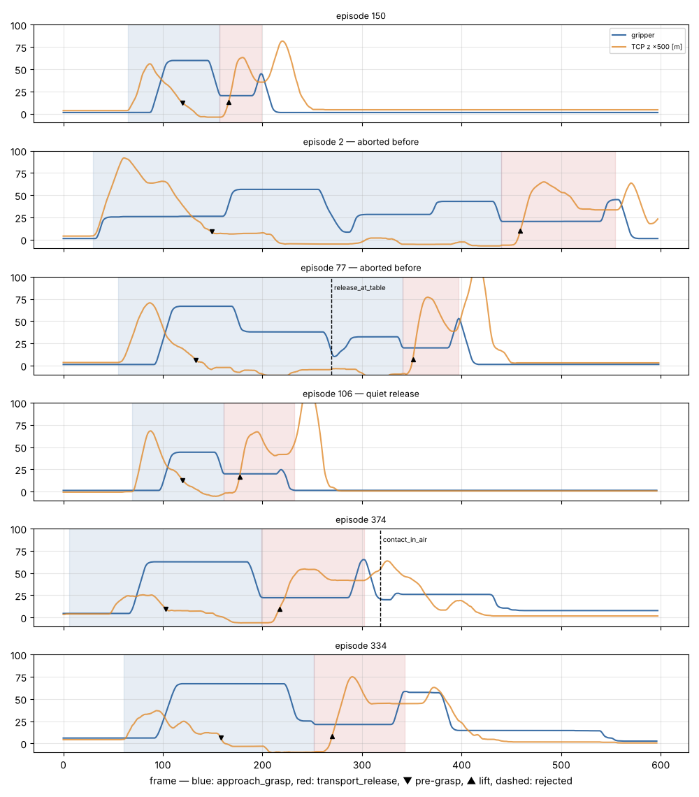
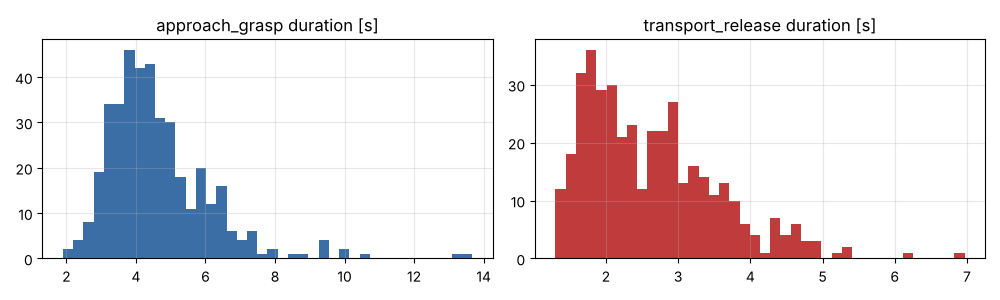
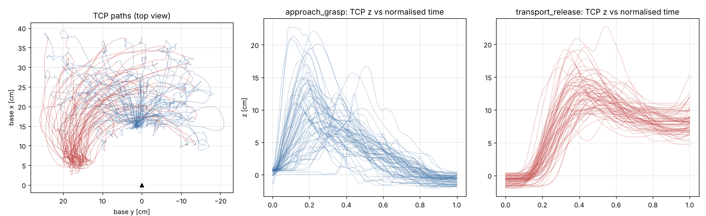

# Segmentation report (Phase 2)

_Generated by `scripts/segment_dataset.py`. Per-cycle table: `docs/segmentation_cycles.csv`._

## Rules

1. **Gripper events** (`segmentation/gripper.py`): median filter (5 frames), hysteresis (OPEN > 25.5, CLOSED < 23.5), OPEN debounce 0.15 s, hold plateau ∈ [13.0, 23.5] lasting ≥ 0.4 s. Cycle = OPEN → HOLD → OPEN.
2. **Quiet releases:** a hold that ends straight in *closed-empty* (opening below the threshold) counts as released at the end of its plateau if the TCP is above 3 cm.
3. **Physical gates** (no stacking): contact at TCP z ≤ 3 cm (else `contact_in_air`); release at TCP z > 3 cm (else `release_at_table` = aborted grasp).
4. **Primitives:** `approach_grasp` = [motion onset or previous cycle end, contact]; `transport_release` = [contact, end of the release opening]. Motion onset = joint speed > 5.0°/s for ≥ 0.2 s. The return to home is discarded. Minimum primitive length 0.5 s.
5. **Keypoints:** pre-grasp = last frame before contact with z ≥ z_contact + 3 cm; lift = first frame after contact above the same height.

## Results

| valid cycles per episode | episodes |
|---|---|
| 1 | 400 |

Rejected candidates: {'release_at_table': 2, 'contact_in_air': 2} — ep 77: release_at_table @ frame 269, ep 365: release_at_table @ frame 171, ep 370: contact_in_air @ frame 361, ep 374: contact_in_air @ frame 318.

- Quiet releases recovered: [106, 143, 168, 221, 234].
- Cycles with a missed/aborted grasp inside the approach (`aborted_before`): [2, 77, 365] — kept in the table, excluded from training by default.
- Durations (p5 / median / p95): approach_grasp 2.90 / 4.33 / 7.17 s, transport_release 1.53 / 2.43 / 4.44 s.
- Release points: all within 5.2 cm of their median (5.7, 16.4, 8.2) cm → the box.

## Keypoint statistics (input for the IK-based planner)

Relative to the contact pose (FK; p5 / median / p95):

| quantity | value |
|---|---|
| pre-grasp height above contact (≈ threshold by definition) | 3.01 / 3.09 / 3.29 cm |
| highest TCP point during approach_grasp | 5.48 / 11.10 / 18.90 cm |
| highest TCP point during transport_release | 9.54 / 12.81 / 18.84 cm |
| pre-grasp horizontal offset from contact | 0.30 / 1.51 / 3.78 cm |
| pre-grasp → contact time | 0.83 / 1.63 / 3.50 s |
| lift height (first frame ≥ threshold) | 3.04 / 3.41 / 3.93 cm |
| contact → lift time | 0.30 / 0.53 / 0.83 s |
| approach pitch at contact | -11.67 / 5.82 / 28.80° |
| approach pitch at release | -7.36 / 5.43 / 30.80° |
| release height above the table plane z = 0 | 6.14 / 8.19 / 10.19 cm |

## Two solutions on the same primitives

Both consume this table and are evaluated with the same leave-one-out protocol (Phase 5):

1. **TP-GMM** (Phase 4): one model per primitive, in the cube and box frames; output [x, y, z, yaw, gripper] (+ pitch, see `kinematics_report.md`), converted to joints by IK.
2. **IK planner** (geometric baseline): per primitive, a few Cartesian waypoints expressed in the same frames — approach: start → pre-grasp (above the cube) → contact; transport: contact → lift → above box → release — with heights, pitch and timing learned as medians of the keypoints above, minimum-jerk interpolation and the same IK. It needs no probabilistic model and makes the value added by TP-GMM measurable.
