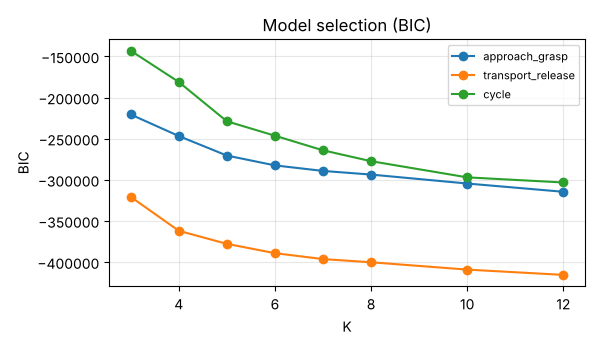
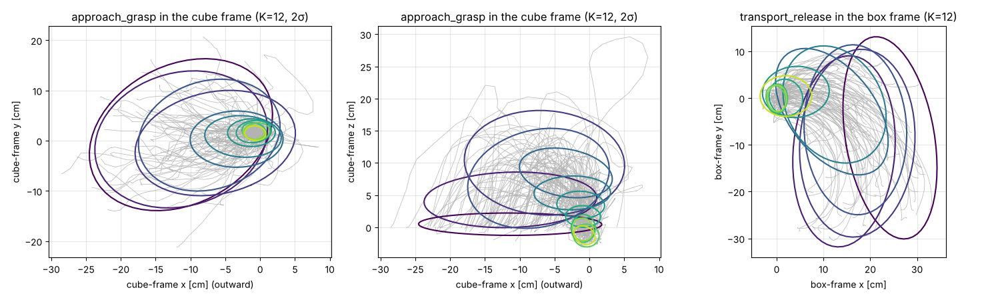
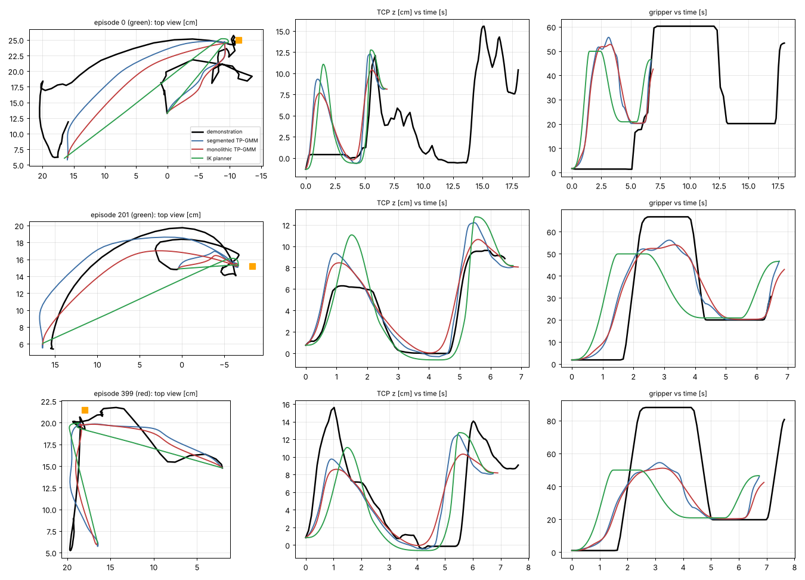

# TP-GMM training report (Phase 4)

_Generated by `scripts/train.py`. In-sample figures only; out-of-sample results are in `docs/evaluation_report.md` (leave-one-out)._

## Data

- 366 cycles (usable vision frame, no missed/aborted grasp), pooled over colours: red 128, green 127, yellow 111.
- Variables `['t', 'x', 'y', 'z', 'h', 'g', 'pitch']`: normalized time (input) → TCP position, outward jaw heading h, gripper, approach pitch. Every primitive is resampled to 50 points (equal weight per demonstration).
- Frames: **cube** from `vision` (position + yaw; the yaw among the 4 equivalent ones closest to the grasp heading), **box** (estimate): (5.7, 16.5, 8.2) cm.
- Learned heading offset at the grasp (circular mean of h − cube azimuth): 13.0° — used to pick the cube yaw at execution.
- Median durations: approach_grasp 4.33 s, transport_release 2.40 s, cycle 6.90 s.

## Model selection

| model | selected K | BIC per K |
|---|---|---|
| approach_grasp | 12 | 3: -220630, 4: -246855, 5: -270561, 6: -282526, 7: -289263, 8: -293694, 10: -304580, 12: -314616 |
| transport_release | 12 | 3: -320753, 4: -362050, 5: -377915, 6: -389240, 7: -396425, 8: -400308, 10: -409221, 12: -415663 |
| cycle | 12 | 3: -143090, 4: -181133, 5: -228922, 6: -246450, 7: -264210, 8: -277432, 10: -297073, 12: -303314 |

BIC keeps decreasing up to the largest K tried: the 50 samples of a demonstration are strongly correlated, so counting each as an independent datapoint under-penalizes complexity. The search range is therefore capped (`tpgmm.k_range`); the leave-one-out evaluation (Phase 5) is the real check against over-fitting.

## In-sample reproductions

Black: demonstration; the three policies are given the same cube pose (vision) and start pose.

## Design decisions

- **Segmented model** (one TP-GMM per primitive) is the main model; the **monolithic** one (a single TP-GMM over the whole cycle, same frames and variables) is the baseline asked for. Time is normalized per primitive in the segmented model, per cycle in the monolithic one.
- **Yaw**: handled as an angular offset of the frame (A = 1, b = frame yaw) and aligned modulo 2π before the product of Gaussians; the outward heading h avoids the ±180° cut of the raw tool yaw.
- **Regularization**: per-dimension diagonal term (`tpgmm.reg`), in each variable's units.
- **IK planner baseline**: median waypoints in the same frames, PCHIP + minimum-jerk; no probabilistic model (`so101_tpgmm/planner/ik_planner.py`).
