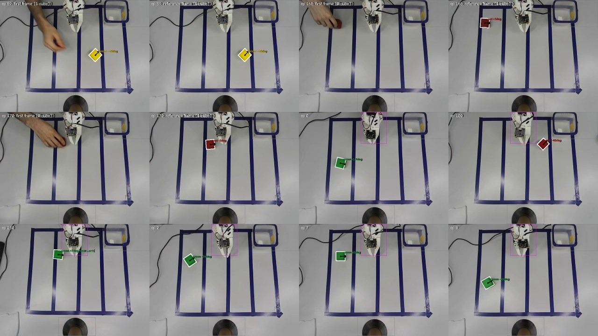
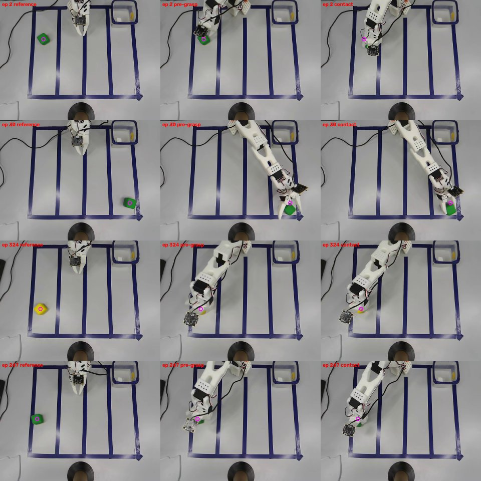
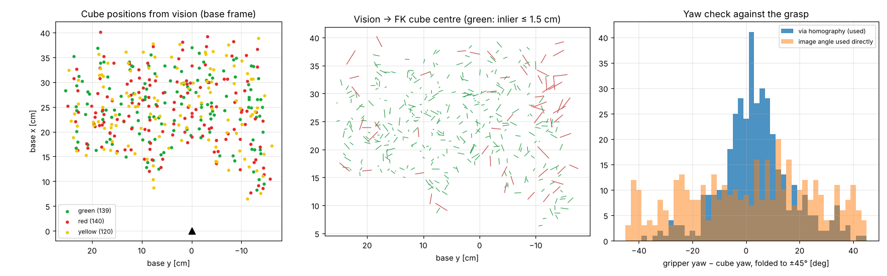

# Vision report (Phase 3)

_Generated by `scripts/vision_pipeline.py`. Per-cycle frames: `docs/cube_frames.csv`._

## Detection

Fixed camera only. Per colour: HSV mask (red = two hue intervals, OpenCV hue wraps at 180) → exclusion boxes (the box, which holds a yellow object, and the camera stand) → opening/closing → connected components → area 900–2600 px, aspect ≤ 1.6, fill ≥ 0.6 → `minAreaRect` (centre, orientation folded to [−45°, 45°) by the cube's 90° symmetry). Ranges in `configs/default.yaml` (`vision.colors`).

| colour | HSV ranges | cycles |
|---|---|---|
| red | H [(0, 10), (170, 179)], S ≥ 120, V ≥ 50 | 140 |
| yellow | H [(18, 35)], S ≥ 120, V ≥ 50 | 120 |
| green | H [(40, 90)], S ≥ 120, V ≥ 50 | 139 |
| blue | H [(100, 130)], S ≥ 150, V ≥ 130 | 0 |

Detections per cycle at the reference frame: {1: 400}. **No blue cube appears in this dataset** (the blue range is kept, with a value floor that rejects the floor tape: tape blobs have S ≈ 110, V ≈ 96).

### Reference frame: why not the first frame

In episodes 59, 168 and 170 the first frame shows the operator's **hand still placing the cube**: in 168/170 the cube is still in the hand (no detection); in 59 the skin passes the red hue/saturation test and is only rejected by the area filter. The scene is observed in the last frame before motion onset (onset − 2 frames): the operator is then on the leader arm and the follower is at rest. With it every cycle has exactly one detection; elsewhere the cube does not move between frame 0 and the reference frame (max 3 px).

### Scene validation

- Arm at home: TCP within 5 cm of the median home TCP (the rest posture varies by up to ~9° per joint between episodes, the TCP by ~3 cm). Flags: `arm_not_home` × 0.
- Static scene: fraction of pixels changing over 0.5 s before the reference frame > 0.002: `scene_not_static` × 3 ([90, 147, 167]).
- Cube next to the arm at rest: `near_arm` × 19 (informative; areas are normal).
- Partial blob (area < 0.7 × expected footprint): `partial_blob` × 3 ([81, 161, 287]). In these the cube is not hidden by the arm but lies on the dark tape, where part of a dark red cube drops out of the mask; the centre can be biased, so they are excluded from training.
- **Cube pushed before the grasp** (`cube_pushed`): the vision position (reference frame) and the FK cube centre at contact differ by more than 20 mm in 25 cycles (57 at 15 mm, 4 at 25 mm). The frames below show the gripper dragging the cube before closing (episode 2: moved by an earlier failed attempt). For these demonstrations the initial cube pose — the frame TP-GMM is conditioned on — is not where the grasp happened, so they are excluded from training.
- Usable cycles (associated, no scene flag, no partial blob, not pushed): **368 / 400**.

## Pixel → base calibration from the dataset

Correspondences: detected cube centre (reference frame) ↔ cube centre at contact from FK, `p_tcp + R_tcp · offset`, with the offset estimated jointly. RANSAC on the homography, then a soft-L1 refit and re-classification (threshold 1.5 cm).

| model | inliers | median error (inliers) | p90 (inliers) | median (all) |
|---|---|---|---|---|
| H + cube offset in TCP frame (used) | 342/400 | 7.6 mm | 12.6 mm | 8.2 mm |
| H, TCP origin | 295/400 | 8.4 mm | 13.0 mm | 10.4 mm |

- Cube centre in the TCP frame: (-7.8, -14.9, -12.3) mm; cube-centre plane at base z = 0.6 cm.
- Lens distortion: no intrinsics configured (`vision.intrinsics: null`); the homography absorbs only the projective part.
- Outliers are **not uniform**: 31 % of the cubes on the robot's right (base y < −5 cm) vs 8 % on its left (y > 5 cm); median error 11.0 vs 7.5 mm. Two causes add up there and cannot be separated with the data alone: the cube is pushed more often when the arm reaches across (see the frames below), and lens distortion grows towards the image edge. Intrinsics (`vision.intrinsics`) would remove the second one. All cycles are kept in the frames table with their error (`position_error_mm`).

### Independent checks with the taped-grid camera calibration (`camera_calibration.md`)

| check | median |
|---|---|
| grid camera, ray ∩ cube-top plane vs this homography | 11.4 mm |
| grid camera, ray ∩ cube-top plane vs FK | 13.9 mm |
| grid camera, ray ∩ **table** plane vs FK (wrong plane) | 16.6 mm (p90 32.9 mm) |

The wrong plane is a silent failure: the mapping still looks smooth and plausible, but every cube is pulled towards the camera nadir by ~h/H. The dataset homography is fitted on the detections themselves, so its plane is consistent by construction. The residual difference between the grid camera and FK includes the 4.7 % FK-vs-tape scale discrepancy (`camera_calibration.md`).

## Yaw

The cube yaw is the `minAreaRect` angle pushed through the homography (two points on the edge direction), then folded to [−45°, 45°). Check: the jaw-closing axis at contact should be aligned with a cube face, i.e. gripper yaw − cube yaw ≈ 0 modulo 90°.

| method | median \|residual\| | p90 |
|---|---|---|
| via homography (used) | 7.3° | 24.7° |
| image angle used directly (wrong: the image is mirrored w.r.t. the table) | 19.1° | 39.4° |

The remaining residual reflects how precisely the teleoperator aligned the gripper (and the cube rotating while the jaws close), not only vision error.

## Frames for TP-GMM

`outputs/cube_frames.csv` holds, per cycle, the **vision** cube frame (`vision_x, vision_y, vision_z, vision_yaw`, the default) and the **FK** alternative (`fk_x, fk_y, fk_z` = cube centre at contact, `fk_yaw` = gripper yaw folded to ±45°), the colour, flags and `usable`. Note for evaluation: the homography is fitted on all episodes, including the one left out in leave-one-out; with ~340 inliers one correspondence has a negligible influence, and this is stated in the evaluation report.
